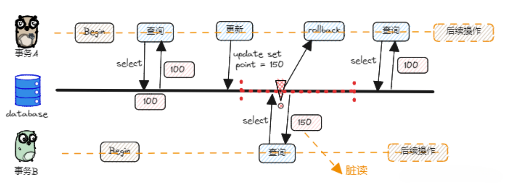
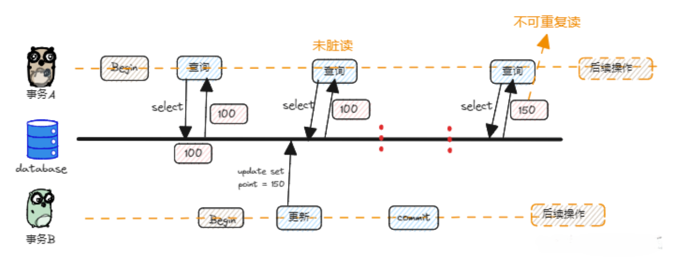
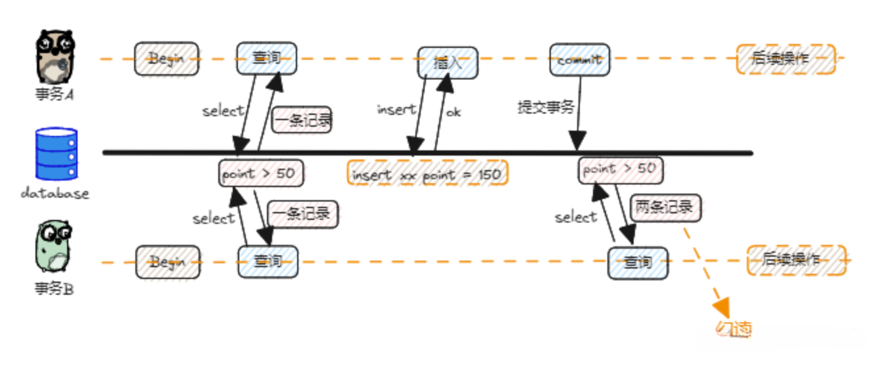

# 示例：分析不同的隔离级别

> 本文是 [事务隔离级别](transaction-isolation.md) 的配套示例。

在数据库中新建测试表 user，对于隔离级别的分析都基于 user 表进行，在分析不同的事务隔离级别的时候都会把问题先下结论，再进行场景分析。

```sql
-- 表结构
CREATE TABLE `user` (
  `id` int NOT NULL AUTO_INCREMENT COMMENT '用户id',
  `name` varchar(32) COLLATE utf8_bin DEFAULT NULL COMMENT '姓名',
  `point` int DEFAULT '0' COMMENT '积分',
  PRIMARY KEY (`id`)
) ENGINE=InnoDB DEFAULT CHARSET=utf8 COLLATE=utf8_bin;

-- 插入一条记录
INSERT INTO user (name, point) VALUES('xiaoxu', 100);
```

**读未提交（read uncommitted）**：问题（可能发生脏读、不可重复读和幻读现象）

脏读：B 读取到 A 未提交的修改（Read UnCommited 级别）



**read committed**：不可重复读，幻读

不可重复读：A 读 100 → B 修改 150 → A 再次读取 150，前后读取结果不一致（Read Committed）



**可重复读（repeatable read）**：可能发生幻读现象

幻读：在事务 B 两次相同的读取中间，事务 A 插入的数据，影响了第二次读取的结果和第一次不同。这种和前一次读到的记录数量不一样了，就感觉发生了幻觉一样，这种现象就被称为幻读。



**串行化（serializable）**：脏读、不可重复读和幻读现象都【不可能会发生】

串行化是 4 种事务隔离级别中隔离效果最好的，解决了脏读、可重复读、幻读的问题，但是效果最差，它将事务的执行变为顺序执行。
