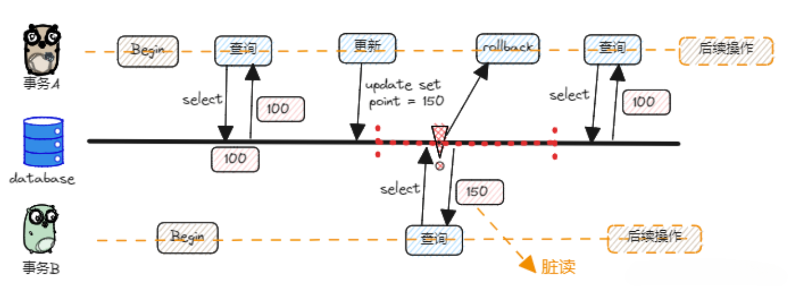
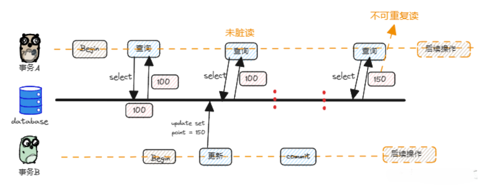
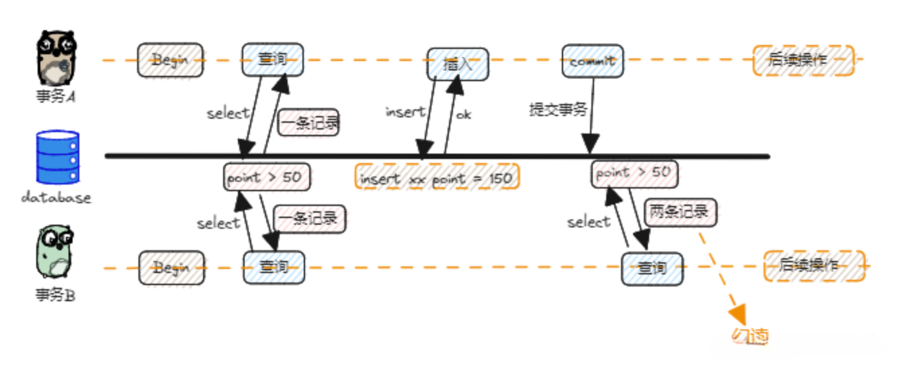

# 事务隔离级别与示例

Transaction isolation is one of the foundations of database processing. Isolation is the I in the acronym ACID; the isolation level is the setting that fine-tunes the balance between performance and reliability, consistency, and reproducibility of results when multiple transactions are making changes and performing queries at the same time.

`InnoDB` offers all four transaction isolation levels described by the SQL:1992 standard: `READ UNCOMMITTED`, `READ COMMITTED`, `REPEATABLE READ`, and `SERIALIZABLE`. The default isolation level for `InnoDB` is `REPEATABLE READ`.

`InnoDB` supports each of the transaction isolation levels described here using different locking strategies. You can enforce a high degree of consistency with the default `REPEATABLE READ` level, for operations on crucial data where ACID compliance is important. Or you can relax the consistency rules with `READ COMMITTED` or even `READ UNCOMMITTED`, in situations such as bulk reporting where precise consistency and repeatable results are less important than minimizing the amount of overhead for locking. `SERIALIZABLE` enforces even stricter rules than `REPEATABLE READ`, and is used mainly in specialized situations, such as with XA transactions and for troubleshooting issues with concurrency and deadlocks.

## REPEATABLE READ

InnoDB 默认的隔离级别。

Consistent reads within the same transaction read the snapshot established by the first read. This means that if you issue several plain (nonlocking) `SELECT` statements within the same transaction, these `SELECT` statements are consistent also with respect to each other.

For locking reads (`SELECT` with `FOR UPDATE` or `FOR SHARE`), `UPDATE`, and `DELETE` statements, locking depends on whether the statement uses a unique index with a unique search condition, or a range-type search condition.

- For a unique index with a unique search condition, `InnoDB` locks only the index record found, not the gap before it.
- For other search conditions, `InnoDB` locks the index range scanned, using gap locks or next-key locks to block insertions by other sessions into the gaps covered by the range.

## READ COMMITTED

Each consistent read, even within the same transaction, sets and reads its own fresh snapshot.

For locking reads (`SELECT` with `FOR UPDATE` or `FOR SHARE`), `UPDATE` statements, and `DELETE` statements, `InnoDB` locks only index records, not the gaps before them, and thus permits the free insertion of new records next to locked records. Gap locking is only used for foreign-key constraint checking and duplicate-key checking.

Because gap locking is disabled, phantom row problems may occur, as other sessions can insert new rows into the gaps.

Only row-based binary logging is supported with the `READ COMMITTED` isolation level. If you use `READ COMMITTED` with `binlog_format=MIXED`, the server automatically uses row-based logging.

Using `READ COMMITTED` has additional effects:

- For `UPDATE` or `DELETE` statements, `InnoDB` holds locks only for rows that it updates or deletes. Record locks for nonmatching rows are released after MySQL has evaluated the `WHERE` condition. This greatly reduces the probability of deadlocks, but they can still happen.
- For `UPDATE` statements, if a row is already locked, `InnoDB` performs a "semi-consistent" read, returning the latest committed version to MySQL so that MySQL can determine whether the row matches the `WHERE` condition of the `UPDATE`. If the row matches (must be updated), MySQL reads the row again and this time `InnoDB` either locks it or waits for a lock on it.

### RC 只锁修改的行（RC holds locks for modified rows）

Consider the table created and populated like this:

```sql
CREATE TABLE t (a INT NOT NULL, b INT) ENGINE = InnoDB;
INSERT INTO t VALUES (1,2),(2,3),(3,2),(4,3),(5,2);
COMMIT;
```

In this case, the table has no indexes, so searches and index scans use the hidden clustered index for record locking rather than indexed columns. 没有索引列，扫描全表（隐藏的 clustered index）。

Suppose that one session performs an `UPDATE`, and a second session performs an `UPDATE` by executing these statements following those of the first session:

```sql
# 数据：(1,2),(2,3),(3,2),(4,3),(5,2)

# Session A
START TRANSACTION;
UPDATE t SET b = 5 WHERE b = 3;

# Session B
UPDATE t SET b = 4 WHERE b = 2;

# >>> REPEATABLE READ
# Session A
x-lock(1,2); retain x-lock
x-lock(2,3); update(2,3) to (2,5); retain x-lock
x-lock(3,2); retain x-lock
x-lock(4,3); update(4,3) to (4,5); retain x-lock
x-lock(5,2); retain x-lock

# Session B
x-lock(1,2); block and wait for first UPDATE to commit or roll back

# >>> Read Committed
# Session A
x-lock(1,2); update(1,2) to (1,4); retain x-lock
x-lock(2,3); unlock(2,3)
x-lock(3,2); update(3,2) to (3,4); retain x-lock
x-lock(4,3); unlock(4,3)
x-lock(5,2); update(5,2) to (5,4); retain x-lock
```

As `InnoDB` executes each `UPDATE`, it first acquires an exclusive lock for each row, and then determines whether to modify it. If `InnoDB` does not modify the row, it releases the lock. Otherwise, `InnoDB` retains the lock until the end of the transaction.

When using the default `REPEATABLE READ` isolation level:

- the first `UPDATE` acquires an x-lock on each row that it reads and does not release any of them
- The second `UPDATE` blocks as soon as it tries to acquire any locks (because first update has retained locks on all rows), and does not proceed until the first `UPDATE` commits or rolls back

If `READ COMMITTED` is used instead:

- the first `UPDATE` acquires an x-lock on each row that it reads and releases those for rows that it does not modify
- For the second `UPDATE`, `InnoDB` does a "semi-consistent" read, returning the latest committed version of each row that it reads to MySQL so that MySQL can determine whether the row matches the `WHERE` condition of the `UPDATE`

However, if the `WHERE` condition includes an indexed column, and `InnoDB` uses the index, only the indexed column is considered when taking and retaining record locks.

In the following example, the first `UPDATE` takes and retains an x-lock on each row where b = 2. The second `UPDATE` blocks when it tries to acquire x-locks on the same records, as it also uses the index defined on column b.

```sql
CREATE TABLE t (a INT NOT NULL, b INT, c INT, INDEX (b)) ENGINE = InnoDB;
INSERT INTO t VALUES (1,2,3),(2,2,4);
COMMIT;

# Session A
START TRANSACTION;
UPDATE t SET b = 3 WHERE b = 2 AND c = 3;

# Session B
UPDATE t SET b = 4 WHERE b = 2 AND c = 4;
```

## READ UNCOMMITTED

`SELECT` statements are performed in a nonlocking fashion, but a possible earlier version of a row might be used. Thus, using this isolation level, such reads are not consistent. This is also called a dirty read.

## SERIALIZABLE

This level is like `REPEATABLE READ`, but `InnoDB` implicitly converts all plain `SELECT` statements to `SELECT ... FOR SHARE` if `autocommit` is disabled. If `autocommit` is enabled, the `SELECT` is its own transaction.

- autocommit：0，Serializable 级别会**隐式**将所有普通 select 转为 `select… for share`（共享锁 Shared Lock，意味着其他事务不能修改），**这个锁一直持有到事务结束**
- autocommit：1，Serializable 级别会将所有普通 select 加上共享锁，同时这个 select 是个独立的微型事务，**select 结束立即释放锁**

It therefore is known to be read only and can be serialized if performed as a consistent (nonlocking) read and need not block for other transactions.

因此如果一个事务确认为只读的，可以使用 Consistent (nonblocking) Read 来执行。读取历史快照，满足了 Serializable 级别要求，而且不需要锁定其他事务。**如果 InnoDB 能够确定一个事务是只读的（READ ONLY TRANSACTION），它就会为了提升性能而选择不使用默认的加锁方式，而是退回到使用和 REPEATABLE-READ 级别一样的"一致性非锁定读"（MVCC 快照）**。

## 分析不同的隔离级别（示例）

在数据库中新建测试表 user，对于隔离级别的分析都基于 user 表进行，在分析不同的事务隔离级别的时候都会把问题先下结论，再进行场景分析。

```sql
-- 表结构
CREATE TABLE `user` (
  `id` int NOT NULL AUTO_INCREMENT COMMENT '用户id',
  `name` varchar(32) COLLATE utf8_bin DEFAULT NULL COMMENT '姓名',
  `point` int DEFAULT '0' COMMENT '积分',
  PRIMARY KEY (`id`)
) ENGINE=InnoDB DEFAULT CHARSET=utf8 COLLATE=utf8_bin;

-- 插入一条记录
INSERT INTO user (name, point) VALUES('xiaoxu', 100);
```

**读未提交（read uncommitted）**：问题（可能发生脏读、不可重复读和幻读现象）

脏读：B 读取到 A 未提交的修改（Read UnCommited 级别）



**read committed**：不可重复读，幻读

不可重复读：A 读 100 → B 修改 150 → A 再次读取 150，前后读取结果不一致（Read Committed）



**可重复读（repeatable read）**：可能发生幻读现象

幻读：在事务 B 两次相同的读取中间，事务 A 插入的数据，影响了第二次读取的结果和第一次不同。这种和前一次读到的记录数量不一样了，就感觉发生了幻觉一样，这种现象就被称为幻读。



**串行化（serializable）**：脏读、不可重复读和幻读现象都【不可能会发生】

串行化是 4 种事务隔离级别中隔离效果最好的，解决了脏读、可重复读、幻读的问题，但是效果最差，它将事务的执行变为顺序执行。
