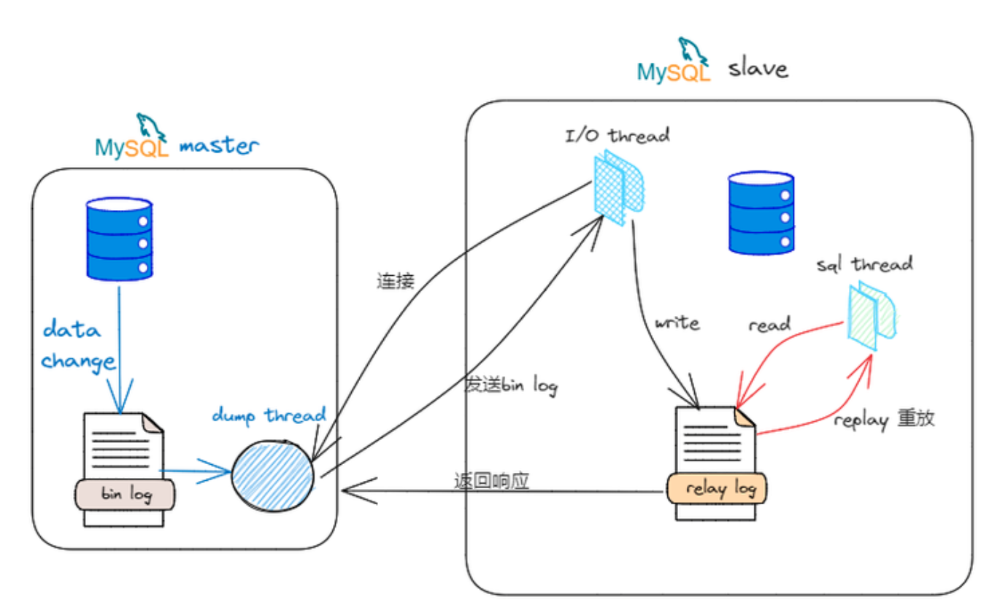

# MySQL 主从复制

MySQL 主从同步（Master-Slave Replication）是一种将主数据库（Master）的数据自动同步到从数据库（Slave）的机制，主要用于实现数据备份、读写分离和负载均衡，提升系统的可用性和扩展性。

### 核心原理

主从同步基于 **"日志复制"** 实现，核心流程可概括为：

整个流程其实就是对 bin log 的写入、同步、重做过程。

- 写入：主库写 bin log 日志，提交事务，并更新本地存储数据
- 同步：从库 I/O 请求 → dump 线程发送 → 写入 relay log
- 重做：重做中继日志 bin log events，并更新存储引擎中的数据

主从同步设计当然有好处了，比如**读写分离、数据备份（保留了多份一样的数据）**。但是如果 slave 增加，从库连接上来的 I/O 线程较多，那么就会对主库资源消耗增大，造成主从延迟。

### 主从复制方式

**同步复制**：MySQL 主库提交事务的线程要等待所有从库的复制成功响应，才返回客户端结果。

**异步复制（默认模型）**：MySQL 主库提交事务的线程并不会等待 binlog 同步到各从库，就返回客户端结果。

**半同步复制**：介于两者之间，事务线程不用等待所有的从库复制成功响应，只要一部分复制成功响应回来就行。

### 主从同步的作用

- **数据备份**：从库作为主库的热备份，主库故障时可快速切换到从库
- **读写分离**：主库负责写操作，从库分担读操作，提高系统吞吐量（如用 MyCat、Sharding-JDBC 实现自动路由）
- **负载均衡**：多从库架构可分散读压力，避免单库瓶颈

### 主从同步的常见问题

1. **同步延迟**：从库 SQL 线程执行速度慢于主库写入速度，导致数据不一致（可通过监控 `Seconds_Behind_Master` 查看延迟时间）。
    - 优化：升级从库硬件、减少从库非必要操作、使用并行复制（MySQL 5.7+ 支持 `slave_parallel_workers`）
2. **数据不一致**：网络中断、从库 SQL 线程报错（如主键冲突）可能导致同步中断，数据偏差。
    - 解决：定期用 `pt-table-checksum` 校验数据一致性，用 `pt-table-sync` 修复偏差
3. **主库故障**：主库宕机后需手动将从库切换为主库，操作复杂（可结合 MGR 或哨兵工具实现自动切换）。
