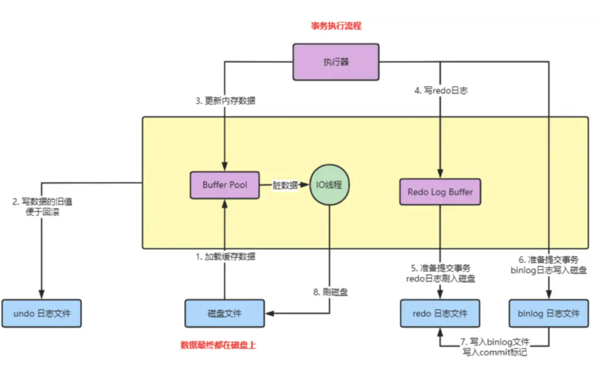
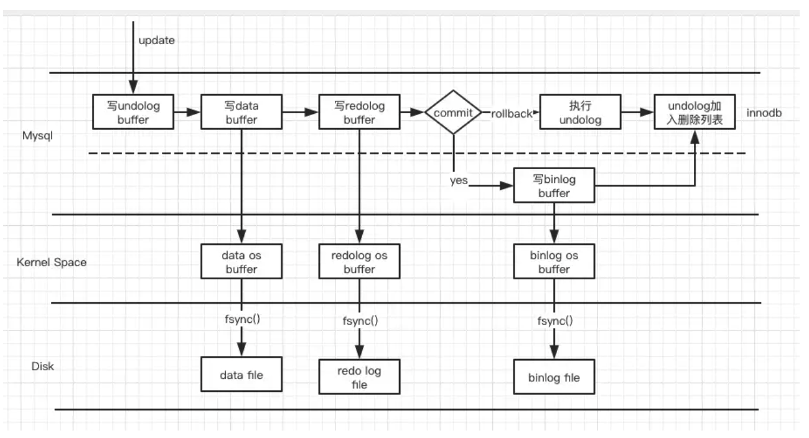

# 番外篇：悬挂事务

### 现象

最近业务系统生产环境的 IDB 在执行事务的过程中出现了 `ERROR 1205 (HY000): Lock wait timeout exceeded; try restarting transaction` 异常。通过相关资料的查询和了解，发现出现这个问题的原因是产生了悬挂事务。整个排查的过程也比较困难，因此和大家分享下排查问题的经过。如果文中有错漏的地方，欢迎大家指正。

### 事务

首先介绍下事务的相关知识。什么是事务？事务就是用户定义的一系列数据库操作，这些操作可以视为一个完成的逻辑处理工作单元，要么全部执行，要么全部不执行，是不可分割的工作单元。

事务的四大特性：原子性（Atomicity）、一致性（Consistency）、隔离性（Isolation）、持久性（Durability）。

mysql innodb 引擎是如何实现上面四个特性的？

1. 事务的隔离性由锁机制 + MVCC 实现。
2. 事务的原子性、一致性和持久性由事务的 redo 日志和 undo 日志来保证。

mysql 的锁主要分为 共享锁（S Lock）、排它锁（X Lock）：

1. 共享锁（S Lock）：共享锁又称为读锁，简称 S 锁，共享锁就是多个事务对于同一数据可以共享一把锁，都能访问到最新数据。但是不能执行 Update、Delete 操作。
2. 排它锁（X Lock）：排它锁又称为写锁，简称 X 锁，排它锁不能与其它锁并存，而且只有一个事务能拿到某一数据行的排它锁，其余事务不能再获取该数据行的所有锁。一旦有一个事务获取了该数据的排它锁之后，其余事务对于该数据的操作将会被阻塞，直至锁释放。常见的排他锁：行锁、间隙锁等等。

mysql 的重要日志：redo log、undo log 和 binlog：

1. **redo log**：重做日志，记录的是事务提交时数据页的物理修改，是用来实现事务的持久性。该日志文件由两部分组成：重做日志缓冲（redo log buffer）以及重做日志文件（redo log file），前者是在内存中，后者在磁盘中。当事务提交之后会把所有修改信息都存到该日志文件中，用于在刷新脏页到磁盘发生错误时进行数据恢复使用。mysql 在进行修改操作的时候并不是直接进行磁盘 IO，因为那样效率太低。而是将修改操作写到缓存区（redo log buffer）中，再在适合的时机进行刷页。为了防止缓存区中的数据因为意外错误丢失，所以会将缓冲区的数据写入到 redo 日志。
2. **undo log**：主要记录的是数据的逻辑变化，为了在发生错误时回滚之前的操作，需要将之前的操作都记录下来，然后在发生错误时才可以回滚。undo log 和 redo log 记录物理日志不一样，它是逻辑日志。可以认为当 delete 一条记录时，undo log 中会记录一条对应的 insert 记录，反之亦然，当 update 一条记录时，它记录一条对应相反的 update 记录。当执行 rollback 时，就可以从 undo log 中的逻辑记录读取到相应的内容并进行回滚。
3. **binlog**：归档日志，属于逻辑日志，是以二进制的形式记录的，用于记录数据库执行的写入性操作（不包括查询）信息。binlog 不仅会记录 insert 操作，还会记录对应的反向操作 delete，binlog 提供基于时间点的数据恢复能力。binlog 的主要使用场景：主从复制和数据恢复。对于数据恢复场景，我们可以通过使用 mysqlbinlog 工具来恢复数据。集团内的 IDB 的数据追踪功能也是利用 binlog 实现的，可用于找回被误操作的数据。

一次事务的执行过程大致如下：





如上图所示，事务执行流程步骤（更新操作）：

1. 查询数据若 Buffer Pool 存在，则输出，不存在则读取磁盘中的数据并放入 Buffer Pool
2. 更新操作，会先将数据的旧值写入 undo log，以便回滚（保证原子性）
3. 更新 Buffer Pool（内存）数据
4. 将更新数据写入到 Redo Log Buffer（内存中）
5. 准备提交事务，会调用 fsync 将 Redo Log Buffer 的值刷入到 redo log 日志文件中，状态为 prepare
6. 准备提交事务，binlog 日志写入磁盘
7. binlog 写入成功后，将 redo log 的状态变更为 commit
8. 在合适的时间，将 Buffer Pool 的数据刷盘

### 什么是悬挂事务

正常的事务流程（人为控制事务提交）：begin, rollback, commit。正常情况下的流程如下：

```sql
beginTransaction;

-- 一顿操作-------

if (操作成功) {
    commit;
} else {
    rollback;
}
```

试想一下，如果我们开启一个事务，但不 rollback 也不 commit 这个事务，会发生什么现象。答案是：事务将一直挂起，事务中获得的锁也不会被释放，其他事务也无法操作被锁定的数据，此时就产生了悬挂事务。伴随着悬挂事务的产生，通常会出现 `ERROR 1205 (HY000): Lock wait timeout exceeded; try restarting transaction` 这个错误。

下面举个简单的例子：

```sql
-- 事务1
set @@autocommit = 0;
BEGIN;
UPDATE student SET age = 11 WHERE id = 2;

-- 事务2
set @@autocommit = 0;
BEGIN;
UPDATE student SET age = 11 WHERE id = 2;
```

事务 1 会获得 id=2 的行锁，然后一直不释放，事务 1 的会话将一直存在。事务 2 也要获得 id=2 的行锁，这时，事务 2 开始等待 id=2 的行锁释放，到了默认的超时时间 50s（mysql 的默认超时时间参数：`innodb_lock_wait_timeout=50`），事务 2 抛出异常：`ERROR 1205 (HY000): Lock wait timeout exceeded; try restarting transaction`。事务 1 除了人为 commit 或者杀死该进程，否则事务 1 的进程永远处于挂起状态（即 sleep 状态）。
