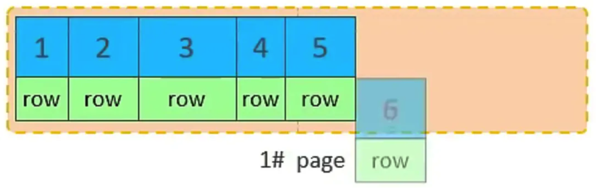
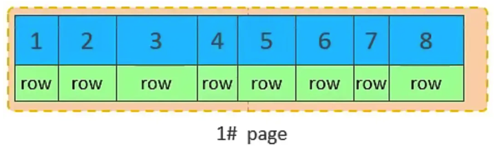
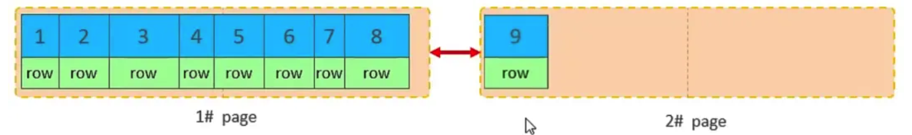
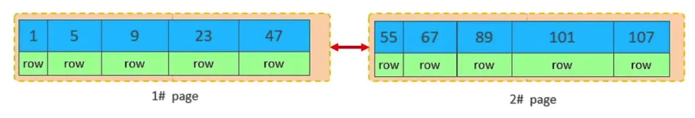
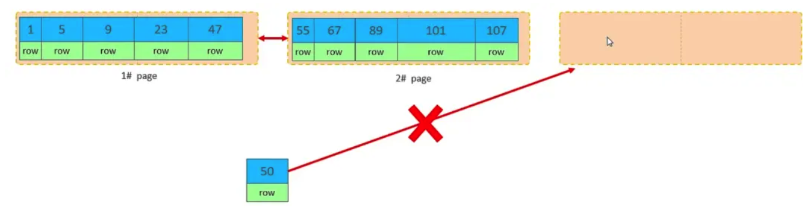
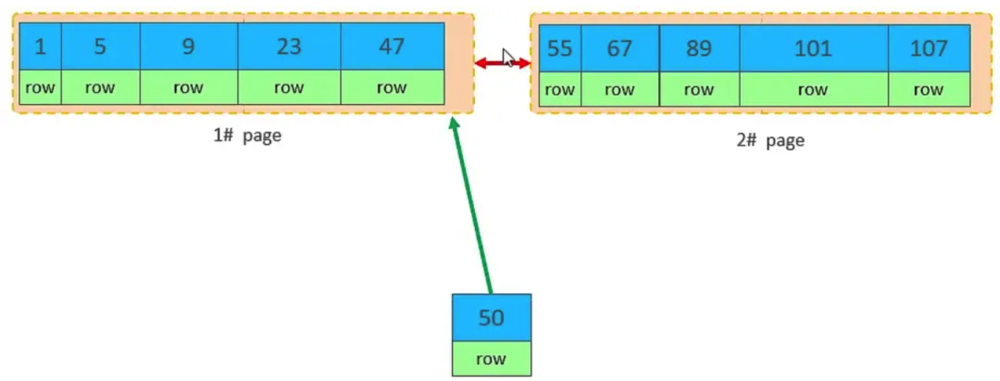
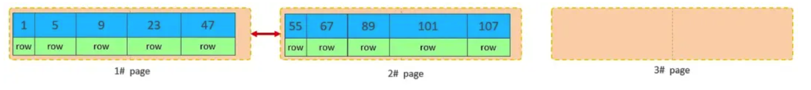
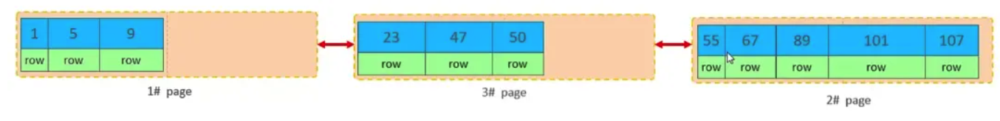

# 页分裂

## 主键优化

### 主键顺序插入

1. 从磁盘中申请数据页，主键顺序插入。当前页未满继续插入。

2. 当前页写满后，再写入第二页，页与页之间通过指针链接。第二页写满了继续写下一页。

### 页分裂问题

1. 假如 1#、2# 页都已经写满了，存放了如图所示的数据。

2. 此时再插入 id 为 50 的记录，会再次开启一个页，写入新的页中吗？

3. 不会。因为索引结构的叶子节点是有顺序的，按照顺序，应该存储在 47 之后。

4. 但是 47 所在的 1# 页已经写满了，存储不了 50 对应的数据了。那么此时会开辟一个新的页 3#。但是并不会直接将 50 存入 3# 页，而是会将 1# 页后一半的数据移动到 3# 页，然后在 3# 页插入 50。

5. 移动数据并插入 id 为 50 的数据之后，这三个页之间的数据顺序是有问题的：1# 的下一个页应该是 3#，3# 的下一个页是 2#。所以此时需要重新设置链表指针。这种现象称之为"页分裂"，是比较耗费性能的操作。

