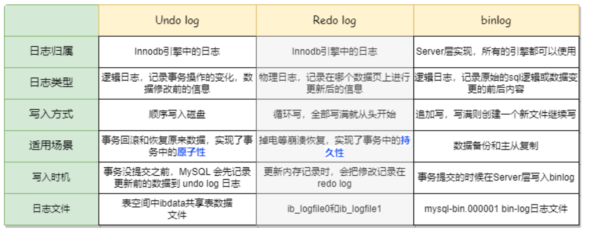
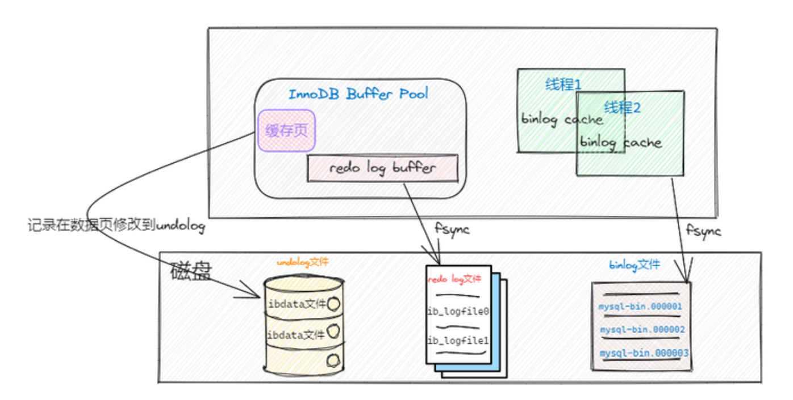
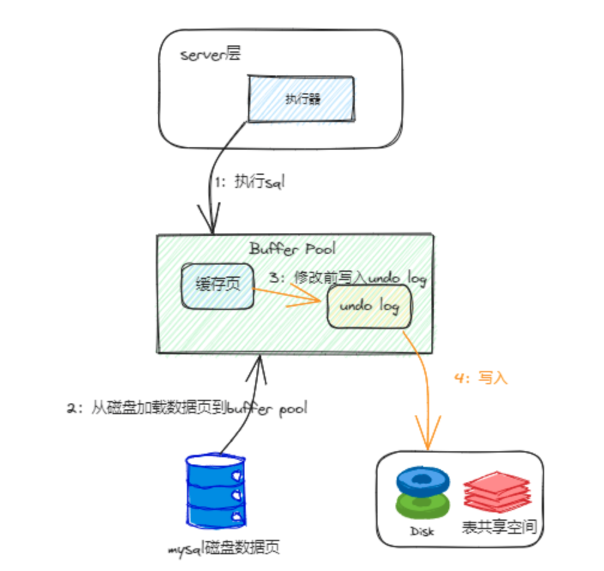
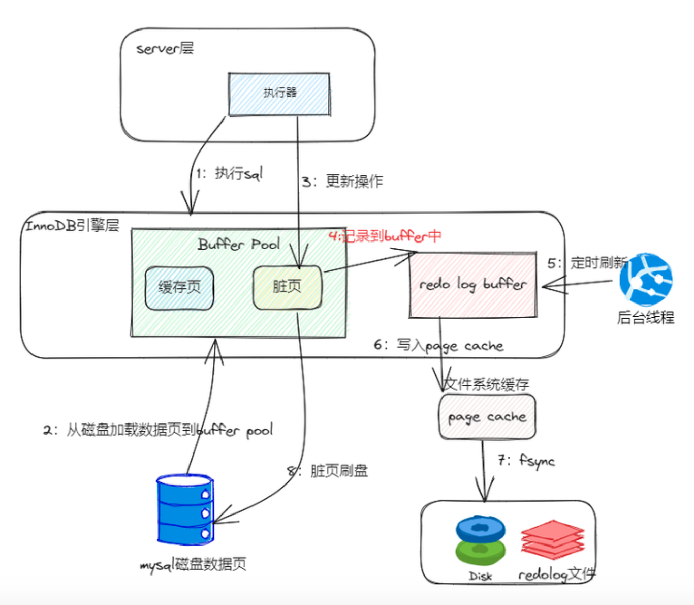
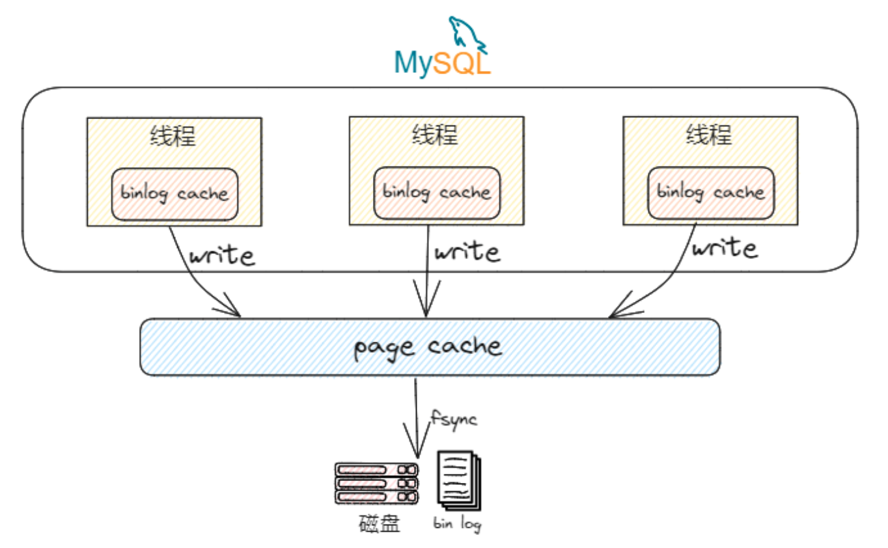

# 日志图示

MySQL中，很多很多的功能也都需要基于日志实现，比如事务回滚、数据持久化、数据恢复、数据迁移、MVCC机制……

简单梳理下日志是在哪个地方写入到不同日志文件中的：

- undolog、redolog都是InnoDB引擎中的日志
- 而binlog在Server层中，位于每条线程中

### Undo log

undo log 叫做回滚日志，它保证了事务的 ACID 特性中的原子性（Atomicity），是引擎层生成的日志，记录的是逻辑操作(`insert|delete|update`)，用于记录数据被修改前的信息。

undo log的两个主要作用是：

- 事务回滚
- 通过ReadView + undo log 实现 【MVCC (多版本并发控制)】

### SQL 执行过程

这里写入redo log buffer就用到了WAL技术，日志先写入redo log buffer缓冲区，然后被后台进程刷盘。而不用等脏页刷入磁盘，通过先将redo log持久化到磁盘中，即使系统崩溃，脏页刷盘失败，也可以通过redo log 的内容，将数据恢复到当前最新的状态。

## Binlog

bin log 主要是记录所有对数据库表结构变更和表数据修改的操作，对于select、show这类读操作并不会记录。

bin log 是在事务提交后在服务层产生的日志，主要作用有两个：

- **数据恢复**：Binlog 详细记录了所有修改数据的 SQL，当某一时刻的数据误操作而导致出问题，或者数据库宕机数据丢失，那么可以根据 Binlog 来回放历史数据。
- **主从复制**：想要做多机备份的业务，可以去监听当前写库的 Binlog 日志，同步写库的所有更改。

### 格式类型

bin log日志有三种格式，分别为statement、row和mixed。

statement：每一条修改数据的 SQL 都会被记录到 bin log 中。

由于只记录对数据库产生变更操作的SQL，日志不会太大，性能会比较不错。但是如果在SQL中使用了sysdate()、now()这类函数，在恢复数据、主从同步数据时，有时会出现数据不一致的情况。

row 模式：记录哪一行数据被修改了。

所以就没有statement模式下动态函数问题，缺点是每行数据变化都会被记录，bin log日志文件会比较大。

mixed模式：statement 和 row 模式的结合版，它会根据不同的情况自动使用 row 模式和 statement 模式。

### 写入方式

binlog是通过追加的方式进行写入的，可以通过max_binlog_size参数设置每个binlog文件的大小，当文件大小达到给定值之后，会生成新的文件来保存日志。

每个日志文件的命名为mysql-bin.000001、mysql-bin.000002、mysql-bin.00000x....，可以通过show binary logs;命令查看已有的bin-log日志文件。

### 刷盘时机和策略

事务执行时，会给每个线程在内存中分配一块地方叫bin log cache，binlog文件就记录在这里，事务提交的时候，再把bin log cache写到bin log文件中。注意，一个事务的bin log不能被拆开提交，无论这个事务多大，也要确保一次性写入，这样才能保证原子性。而对于 InnoDB 存储引擎而言，只有在事务提交时才会记录bin log ，此时记录还在内存中。

我们来看看在内存中的bin log何时保存到磁盘中，也就是【刷盘时机】。

图中 fsync，就是将数据持久化到磁盘的操作，而write还只是把日志写到page cache的bin log文件中，还没有持久化到磁盘。

!!! note "提示"
    write 和fsync的时机和频率，是由参数sync_binlog控制，该参数控制着二进制日志写入磁盘的过程，该参数的有效值为0 、1、N

- sync_binlog = 0 ：提交事务都只 write，不 fsync，此时数据在page cache，后续交由操作系统决定何时将数据持久化到磁盘
- sync_binlog = 1 ：提交事务都会 write，然后马上执行 fsync
- sync_binlog = N(N>1) ：提交事务都 write，但累积 N 个事务后才 fsync

从上面可以看出，syncbinlog 最安全的是设置是1 ，但是将这个参数设为1以上的数值会提高数据库的性能的损耗，而操作系统默认设置的是sync_binlog = 0。
