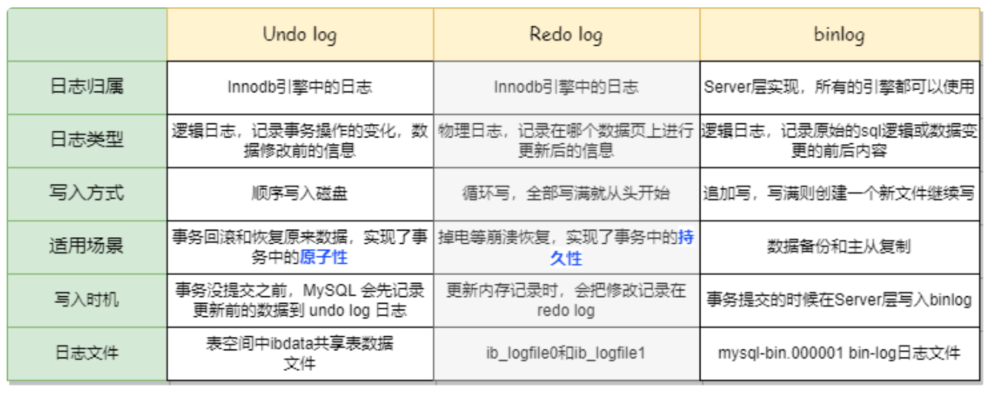
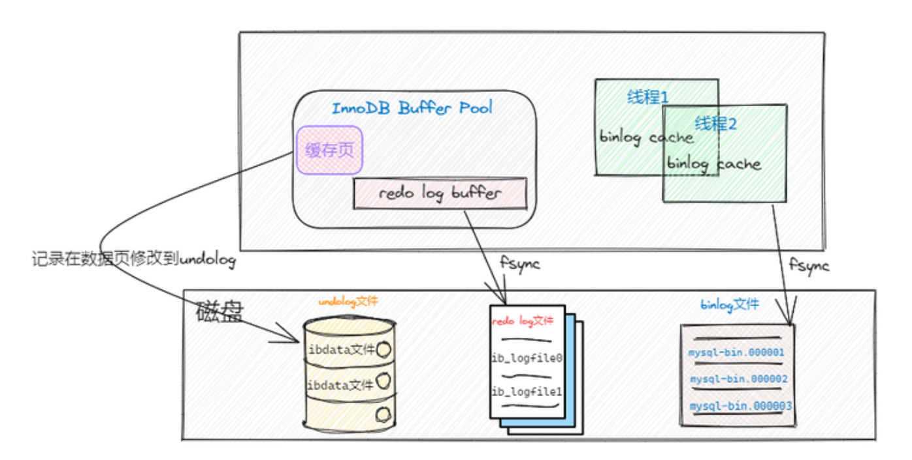
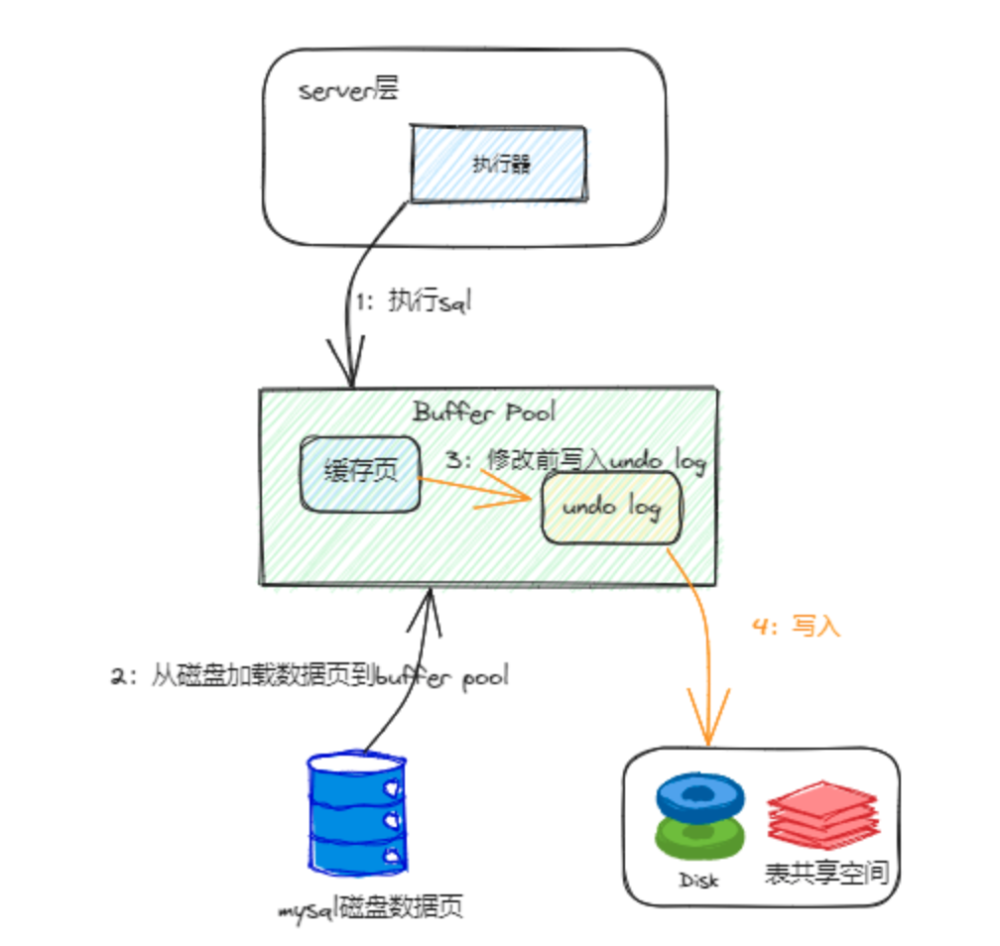
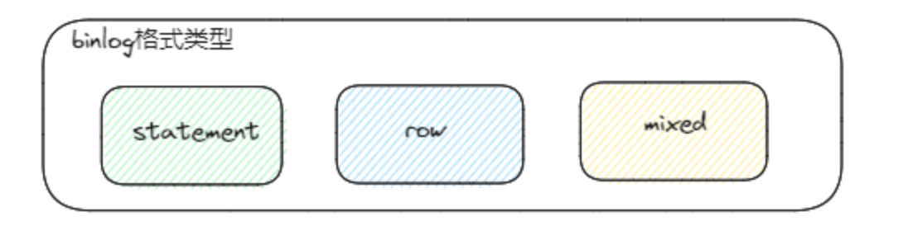
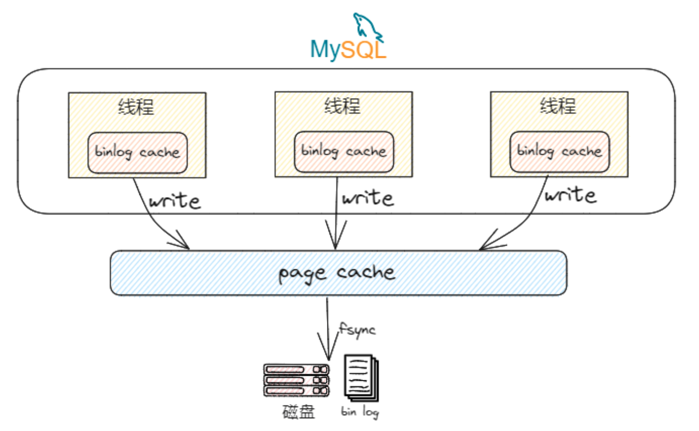
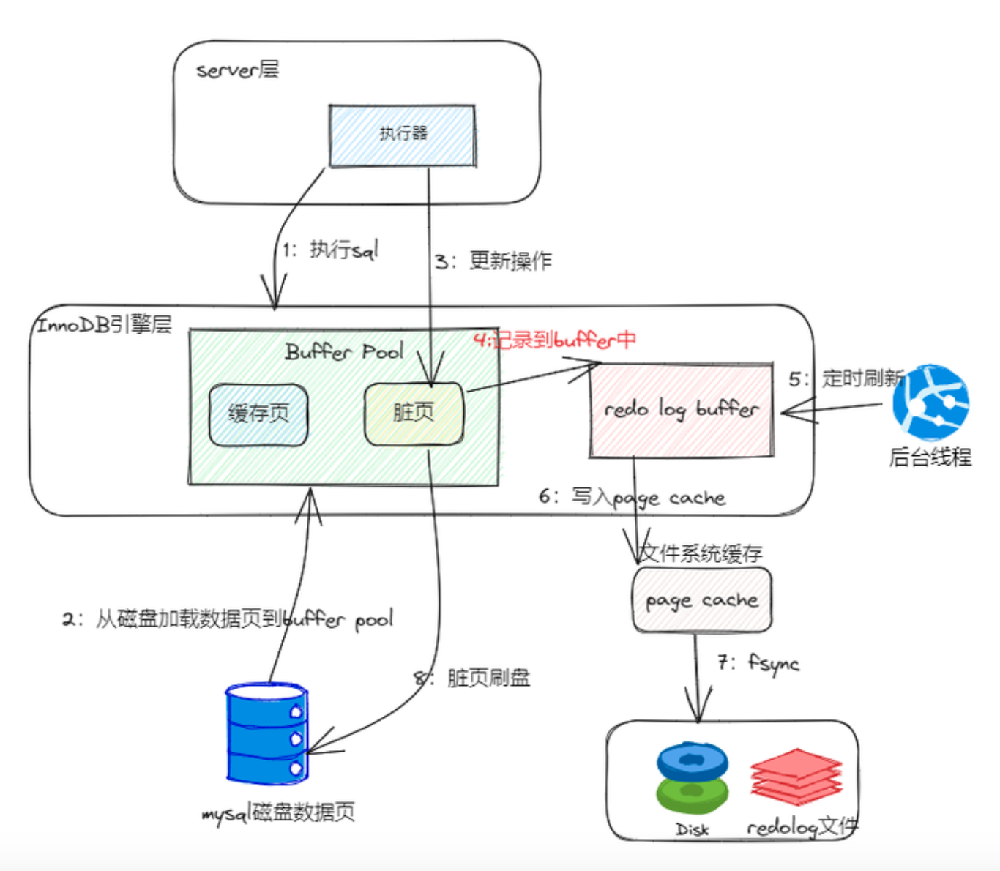

# MySQL 日志详解

MySQL 中很多功能都基于日志实现，比如事务回滚、数据持久化、数据恢复、数据迁移、MVCC 机制等。本文从日志类型总览讲起，逐层剖析各日志的原理，最后对比三种核心日志的协作关系。

## 日志类型总览

MySQL Server 层提供多种日志：

| **Log Type** | **Information Written to Log** |
| --- | --- |
| Error log | Problems encountered starting, running, or stopping [mysqld](https://dev.mysql.com/doc/refman/8.4/en/mysqld.html) |
| General query log | Established client connections and statements received from clients |
| **Binary log** | Statements that change data (also used for replication) |
| Relay log | Data changes received from a replication source server |
| Slow query log | Queries that took more than [`long_query_time`](https://dev.mysql.com/doc/refman/8.4/en/server-system-variables.html#sysvar_long_query_time) seconds to execute |
| DDL logs | Atomic DDL operations performed by DDL statements |

其中与事务和数据恢复最紧密相关的是三种日志：

- **binlog** 是 Server 层的日志
- **redo log** 和 **undo log** 是存储引擎层（InnoDB）的日志

## 日志体系与写入位置

- undolog、redolog 都是 InnoDB 引擎中的日志
- 而 binlog 在 Server 层中，位于每条线程中

## Undo Log

undo log 叫做回滚日志，它保证了事务的 ACID 特性中的原子性（Atomicity），是引擎层生成的日志，记录的是逻辑操作(`insert|delete|update`)，用于记录数据被修改前的信息。

undo log 的两个主要作用是：

- 事务回滚
- 实现多版本控制（MVCC）支持一致性读（[Consistent Read](../terms/consistent-read.md)）

**事务可以进行回滚从而保证事务操作原子性则是通过 undo log 来保证的**。

要对事务数据回滚到历史的数据状态，所以我们也能猜到 undo log 是保存的是数据的历史版本，通过历史版本让数据在任何时候都可以回滚到某一个事务开始之前的状态。undo log 除了进行事务回滚的日志外还有一个作用，就是为数据库提供 [MVCC](https://zhuanlan.zhihu.com/p/52977862) 多版本数据读的功能。

**undo log 记录内容**

在 Mysql 里数据每次修改前，都首先会把修改之前的数据作为历史保存一份到 undo log 里面的，数据里面会记录操作该数据的事务 ID，然后我们可以通过事务 ID 来对数据进行回滚。

比如我们执行 `update user_info set name =“李四”where id=1` 的时候，整个 undo log 的记录形式会如下。

**1、首先准备一张原始数据表**

**2、开启一个事务A：** 对 user_info 表执行 update 会进行如下流程操作

1. 首先获得一个事务编号 104
2. 把 user_info 表修改前的数据拷贝到 undo log
3. 修改 user_info 表 id=1 的数据
4. 把修改后的数据事务版本号改成当前事务版本号，并把 DB_ROLL_PTR 地址指向 undo log 数据地址

**3、最后执行完结果**

## Redo Log

The redo log is a disk-based data structure used during crash recovery to correct data written by incomplete transactions.

During normal operations, the redo log encodes requests to change table data that result from SQL statements or low-level API calls.

Modifications that did not finish updating data files before an unexpected shutdown are replayed automatically during initialization and before connections are accepted.

The redo log is physically represented on disk by redo log files. Data that is written to redo log files is encoded in terms of records affected, and this data is collectively referred to as redo. The passage of data through redo log files is represented by an ever-increasing [LSN](../terms/lsn.md) value. Redo log data is appended as data modifications occur, and the oldest data is truncated as the [checkpoint](../terms/checkpoint.md) progresses.

!!! note "提示"
    redo log 是由物理磁盘的 redo log 文件表示

    写入 redo log 文件的数据是根据受影响的行数编码的，这些数据统称为 redo

    数据在 redolog 文件中的通过情况，由一个不断增长的 LSN 值表示

    当数据修改发生时，redolog 数据被追加写入，并随着 checkpoint 的推进最旧的数据被截断

保障事务的持久性，一旦事务提交不会因为崩溃宕机而导致数据丢失。因为 redolog 可以根据 CheckPoint 来恢复。

写入顺序：Log Buffer → Page Cache → Disk

根据参数 `innodb_flush_log_at_trx_commit` 的刷盘策略：

- 0：事务提交后留在 LogBuffer 中，每隔一秒定期刷盘（延迟写）
- 1：事务提交后立即刷盘，先写 PageCache，然后立即 fsync() 写磁盘（实时写，实时刷盘）
- 2：事务提交后写入 PageCache，然后由操作系统决定何时刷入磁盘（实时写，延迟刷盘）

!!! note "提示"
    此外，redo log buffer 占用到了一定程度（innodb_log_buffer_size 设置的值一半）时，也会把 redo log buffer 中的数据刷盘

## Binlog

bin log 主要是记录所有对数据库表结构变更和表数据修改的操作，对于 select、show 这类读操作并不会记录。

bin log 是在事务提交后在服务层产生的日志，主要作用有两个：

- **数据恢复**：Binlog 详细记录了所有修改数据的 SQL，当某一时刻的数据误操作而导致出问题，或者数据库宕机数据丢失，那么可以根据 Binlog 来回放历史数据
- **主从复制**：想要做多机备份的业务，可以去监听当前写库的 Binlog 日志，同步写库的所有更改

具体用途上，还包括**数据复制**（主从复制 Replication）和**按时间点恢复**（Point-in-Time Recovery）。

### 格式类型

bin log 日志有三种格式，分别为 statement、row 和 mixed。

- **statement**：每一条修改数据的 SQL 都会被记录到 bin log 中。由于只记录对数据库产生变更操作的 SQL，日志不会太大，性能会比较不错。但是如果在 SQL 中使用了 `sysdate()`、`now()` 这类函数，在恢复数据、主从同步数据时，有时会出现数据不一致的情况。
- **row**：记录哪一行数据被修改了。所以就没有 statement 模式下动态函数问题，缺点是每行数据变化都会被记录，bin log 日志文件会比较大。
- **mixed**：statement 和 row 模式的结合版，它会根据不同的情况自动使用 row 模式和 statement 模式。

这三种模式需要注意的是：使用 row 格式的 binlog 时，在进行数据同步或恢复的时候不一致的问题更容易被发现，因为它是基于数据行记录的。而使用 mixed 或者 statement 格式的 binlog 时，很多事务操作都是基于 SQL 逻辑记录，一个 SQL 在不同的时间点执行产生的数据变化和影响是不一样的，所以这种情况下，数据同步或恢复的时候就容易出现不一致的情况。

### 写入方式

binlog 是通过追加的方式进行写入的，可以通过 `max_binlog_size` 参数设置每个 binlog 文件的大小，当文件大小达到给定值之后，会生成新的文件来保存日志。

每个日志文件的命名为 `mysql-bin.000001`、`mysql-bin.000002`、`mysql-bin.00000x`……，可以通过 `show binary logs;` 命令查看已有的 bin-log 日志文件。

写入链路：[事务开始] → binlog cache → Page Cache → Disk

### 刷盘时机和策略

事务执行时，会给每个线程在内存中分配一块地方叫 bin log cache，binlog 文件就记录在这里，事务提交的时候，再把 bin log cache 写到 bin log 文件中。注意，一个事务的 bin log 不能被拆开提交，无论这个事务多大，也要确保一次性写入，这样才能保证原子性。而对于 InnoDB 存储引擎而言，只有在事务提交时才会记录 bin log，此时记录还在内存中。

图中 fsync 就是将数据持久化到磁盘的操作，而 write 还只是把日志写到 page cache 的 bin log 文件中，还没有持久化到磁盘。write 和 fsync 的时机和频率由参数 `sync_binlog` 控制：

- **sync_binlog = 0**：提交事务都只 write，不 fsync，此时数据在 page cache，后续交由操作系统决定何时将数据持久化到磁盘。这种方式性能最高，因为减少了 I/O 操作的次数，但 MySQL 崩溃时会有丢失日志的风险。
- **sync_binlog = 1**：提交事务都会 write，然后马上执行 fsync。最安全，但性能损耗最大。
- **sync_binlog = N（N>1）**：提交事务都 write，但累积 N 个事务后才 fsync，此时 MySQL 崩溃会有丢失 N 个事务日志的风险。

从上面可以看出，`sync_binlog` 最安全的设置是 1，操作系统默认设置的是 `sync_binlog = 0`。

## 三种日志对比与协作

### 核心区别

*redolog vs binlog*：binlog 记录的是表记录的修改（ROW 模式），redolog 记录的是数据页的修改。

mysql 数据刷盘时以数据页（16K）为单位进行写入（磁盘多个扇区）无法保证原子性，如果崩溃时磁盘部分扇区成功部分失败，通过 binlog 是无法恢复的（已经成功的如果强行回滚会不一致）。

redolog 记录磁盘数据页的修改，可以进行灾难恢复 Crash-Safe。

binlog 是随机写入的，而 redolog 是顺序写入的。

### SQL 执行过程

这里写入 redo log buffer 就用到了 WAL 技术，日志先写入 redo log buffer 缓冲区，然后被后台进程刷盘。而不用等脏页刷入磁盘，通过先将 redo log 持久化到磁盘中，即使系统崩溃，脏页刷盘失败，也可以通过 redo log 的内容，将数据恢复到当前最新的状态。

### 生成流程与崩溃恢复

当我们执行 `update user_info set name =“李四”where id=1` 的时候大致流程如下：

**1、从磁盘读取到 id=1 的记录，放到内存。**

**2、记录 undo log 日志。**

**3、记录 redo log（预提交状态）**

**4、修改内存中的记录。**

**5、记录 binlog**

**6、提交事务，写入 redo log（commit 状态）**

**1、在第一步、第二步、第三步执行时数据库崩溃**：因为这个时候数据还没有发生任何变化，所以没有任何影响，不需要做任何操作。

**2、在第四步修改内存中的记录时数据库崩溃**：因为此时事务没有 commit，所以这里要进行数据回滚，会通过 undo log 进行数据回滚。

**3、第五步写入 binlog 时数据库崩溃**：这里和第四步一样的逻辑，此时事务没有 commit，所以这里要进行数据回滚，会通过 undo log 进行数据回滚。

**4、执行第六步事务提交时数据库崩溃**：如果数据库在这个阶段崩溃，那其实事务还是没有提交成功，但是这里并不能像之前一样对数据进行回滚，因为在提交事务前 binlog 可能成功写入磁盘了，所以这里要根据两种情况来做决定。

如果 binlog 存在事务记录：那么就**"认为"**事务已经提交了，这里可以根据 redo log 对数据进行重做。其实你应该有疑问，其实这个阶段发生崩溃了，最终的事务是没提交成功的，这里应该对数据进行回滚。这里主要的一个考虑是因为 binlog 已经成功写入了，而 binlog 写入后，那么依赖于 binlog 的其它扩展业务（比如：从库已经同步了日志进行数据的变更）数据就已经产生了，如果这里进行数据回滚，那么势必就会造成主从数据的不一致。

另外一种情况就是 binlog 不存在事务记录，那么这种情况事务还未提交成功，所以会对数据进行回滚。
