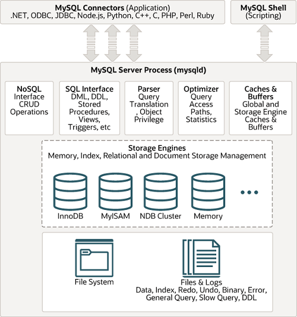
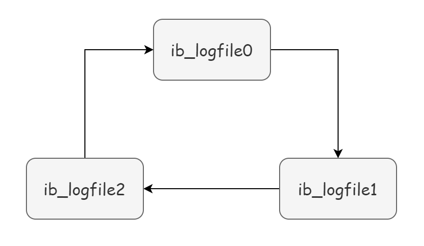
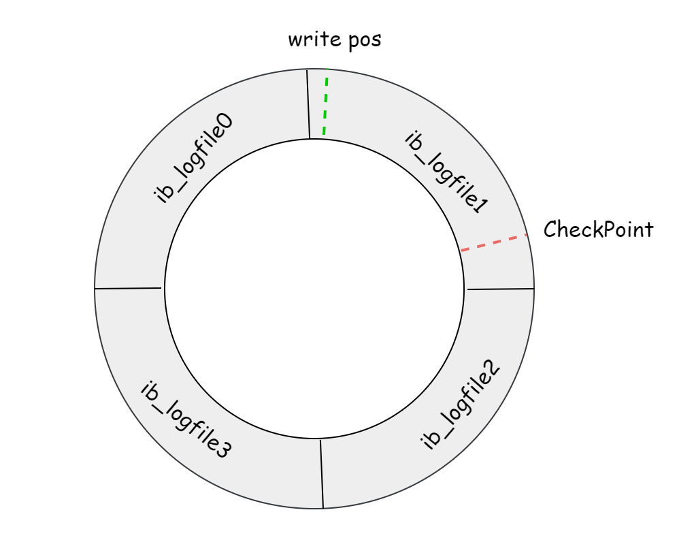

# MySQL 架构总览

### 连接层

功能：负责处理客户端与MySQL服务器之间的连接。它监听特定端口，接收客户端的连接请求，并验证用户身份和权限。多个客户端连接进来后，连接层会管理这些连接，为后续的SQL执行分配资源。

### 服务层

1. SQL接口：接受客户端发送的SQL语句，对SQL进行语法解析和预处理，例如检查SQL语句的语法是否正确，解析表名、列名等信息。
2. 查询优化器：分析SQL语句，生成多种可能的执行计划，并从中选择最优的执行计划。它会考虑表的索引情况、数据分布等因素。例如，对于`SELECT * FROM users WHERE age > 30`这样的查询，查询优化器会判断是否有`age`列的索引，如果有，是使用索引扫描还是全表扫描更高效。
3. 缓存：MySQL有查询缓存，它会缓存查询语句及其结果。当相同的查询再次执行时，如果缓存命中，直接返回缓存结果，无需再次执行查询，从而提高查询性能。但在高并发写操作场景下，查询缓存的维护成本较高，因为数据更新时缓存需要同步更新。

### 存储引擎层

1. 特点：这是MySQL架构中可插拔的部分，不同的存储引擎有不同的特点和适用场景。常见的存储引擎有InnoDB和MyISAM。
2. InnoDB：支持事务，具有行级锁，适合处理大量的并发读写操作，是MySQL 5.5版本之后的默认存储引擎。
3. MyISAM：不支持事务，以表级锁为主，查询性能较高，但在写操作时会锁定整个表，并发写性能较差。适用于一些读多写少的场景，比如简单的博客系统。

InnoDB 存储引擎是基于磁盘存储的，并将其中的记录按照**页**的方式进行管理。因此可将其视为**基于磁盘的数据库系统**（Disk-base Database），在这样的系统中，众所周知，由于 CPU 速度与磁盘速度之间的不匹配，通常会使用**缓冲池**技术来提高数据库的整体性能。

具体来说，缓冲池其实就是一块内存区域，在 CPU 与磁盘之间加入内存访问，通过内存的速度来弥补磁盘速度较慢对数据库性能的影响。

“读取页” 操作的具体步骤就是这样的：

- 首先将从磁盘读到的页存放在缓冲池中
- 下一次再读相同的页时，首先判断该页是否在缓冲池中。若在缓冲池中，称该页在缓冲池中被命中，直接读取该页。否则，读取磁盘上的页。

“修改页” 操作的具体步骤就是这样的：

- 首先修改在缓冲池中的页；然后再以一定的频率刷新到磁盘上。

所谓 ”**脏页**“ 就发生在修改这个操作中，如果缓冲池中的页已经被修改了，但是还没有刷新到磁盘上，那么我们就称缓冲池中的这页是 ”脏页“，即缓冲池中的页的版本要比磁盘的新。
至此，综上所述，我们可以得出这样的结论：**缓冲池的大小直接影响着数据库的整体性能**。

**后台线程**
后台线程其实最大的作用就是用来完成 “将从磁盘读到的页存放在缓冲池中” 以及 “将缓冲池中的数据以一定的频率刷新到磁盘上” 这俩个操作的，当然了，还有其他的作用。以下是《MySQL 技术内幕：InnoDB 存储引擎 - 第 2 版》对于后台线程的描述：

> 后台线程的主要作用就是刷新内存池中的数据，保证内存池中缓存的是最近的数据；此外将已修改的数据文件刷新到磁盘文件，同时保证在数据库发生异常的情况下 InnoDB 能恢复到正常运行状态。
>

另外，**InnoDB 存储引擎是多线程的模型**，也就是说它拥有多个不同的后台线程，负责处理不同的任务。这里简单列举下几种不同的后台线程：

- **Master Thread**：主要负责将缓冲池中的数据异步刷新到磁盘，保证数据的一致性
- **IO Thread**：在 InnoDB 存储引擎中大量使用了 AIO（Async IO）来处理写 IO 请求，这样可以极大提高数据库的性能。IO Thread 的工作主要是负责这些 IO 请求的回调（call back）处理
- **Purge Thread**：回收已经使用并分配的 undo 页
- **Page Cleaner Thread**：将之前版本中脏页的刷新操作都放入到单独的线程中来完成。其目的是为了减轻原 Master Thread 的工作及对于用户查询线程的阻塞，进一步提高 InnoDB 存储引擎的性能

**redo log 与 WAL 策略**

上文我们提到，当缓冲池中的某页数据被修改后，该页就被标记为 ”脏页“，脏页的数据会被定期刷新到磁盘上。

倘若每次一个页发生变化，就将新页的版本刷新到磁盘，那么这个开销是非常大的。并且，如果热点数据都集中在某几个页中，那么数据库的性能将变得非常差。另外，如果在从缓冲池将页的新版本刷新到磁盘时发生了宕机，那么这个数据就不能恢复了。

所以，为了避免发生数据丢失的问题，当前事务数据库系统普遍都采用了 WAL（`Write Ahead Log`，**预写日志**）策略：即**当事务提交时，先写重做日志（redo log），再修改页（先修改缓冲池，再刷新到磁盘）；当由于发生宕机而导致数据丢失时，通过 redo log 来完成数据的恢复**。这也是事务 ACID 中 Durability 持久性的要求。

每个 InnoDB 存储引擎**至少**有 1 个重做日志文件组（ redo log group），每个文件组下至少有 2 个重做日志文件（redo log file），默认的话是一个 redo log group，其中包含 2 个 redo log file：`ib_logfile0` 和 `ib_logfile1`

一般来说，为了得到更高的可靠性，用户可以设置多个镜像日志组（mirrored log groups），将不同的文件组放在不同的磁盘上，以此提高 redo log 的高可用性。在日志组中每个 redo log file 的大小一致，并以**循环写入**的方式运行。

InnoDB 存储引擎会先写 redo log file 0，当 file 0 被写满的时候，会切换至 redo log file 1，当 file 1 也被写满时，会切换到 redo log file 2 中，而当 file 2 也被写满时，会再切换到  file 0 中。

可以看出，redo log file 的大小设置对于 InnoDB 存储引擎的性能有着非常大的影响：

- redo log file 不能设置得太大，如果设置得很大，在恢复时可能需要很长的时间
- redo log file 又不能设置得太小了，否则可能导致一个事务的日志需要多次切换重做日志文件

**CheckPoint技术**

有了 redo log 就可以高枕无忧了吗？显然不是这么简单，我们仍然面临这样 3 个问题：

1）缓冲池不是无限大的，也就是说不能没完没了的存储我们的数据等待一起刷新到磁盘

2）redo log 是循环使用而不是无限大的，那么当所有的 redo log file 都写满了怎么办？

3）当数据库运行了几个月甚至几年时，这时如果发生宕机，重新应用 redo log 的时间会非常久，此时恢复的代价将会非常大。

因此 Checkpoint 技术的目的就是解决上述问题：

- **缓冲池不够用时，将脏页刷新到磁盘**：所谓缓冲池不够用的意思就是缓冲池的空间无法存放新读取到的页，这个时候 InnoDB 引擎会怎么办呢？LRU 算法。InnoDB 存储引擎对传统的 LRU 算法做了一些优化，用其来管理缓冲池这块空间。

    总的思路还是传统 LRU 那套，具体的优化细节这里就不再赘述了：即最频繁使用的页在 LRU 列表（LRU List）的前端，最少使用的页在 LRU 列表的尾端；当缓冲池的空间无法存放新读取到的页时，将首先释放 LRU 列表中尾端的页。这个被释放出来（溢出）的页，如果是脏页，那么就需要强制执行 CheckPoint，将脏页刷新到磁盘中去。

- **redo log 不可用时，将脏页刷新到磁盘**：

    所谓 redo log 不可用就是所有的 redo log file 都写满了。但事实上，其实 redo log 中的数据并不是时时刻刻都是有用的，那些已经不再需要的部分就称为 ”可以被重用的部分“，即当数据库发生宕机时，数据库恢复操作不需要这部分的 redo log，因此这部分就可以被覆盖重用（或者说被擦除）。

    !!! note "提示"

        举个例子来具体解释下：一组 4 个文件，每个文件的大小是 1GB，那么总共就有 4GB 的 redo log file 空间。write pos 是当前 redo log 记录的位置，随着不断地写入磁盘，write pos 也不断地往后移，就像我们上文说的，写到 file 3 末尾后就回到 file 0 开头。CheckPoint 是当前要擦除的位置（将 Checkpoint 之前的页刷新回磁盘），也是往后推移并且循环的：

        

        **write pos 和 CheckPoint 之间的就是 redo log file 上还空着的部分，可以用来记录新的操作**。
        如果 write pos 追上 CheckPoint，就表示 redo log file 满了，这时候不能再执行新的更新，得停下来先覆盖（擦掉）一些 redo log，把 CheckPoint 推进一下。

        综上所述，Checkpoint 所做的事情无外乎是将缓冲池中的脏页刷新到磁盘。不同之处在于每次刷新多少页到磁盘，每次从哪里取脏页，以及什么时间触发 Checkpoint。在 InnoDB 存储引擎内部，有两种 Checkpoint:

        - **Sharp Checkpoint**：发生在数据库关闭时将所有的脏页都刷新回磁盘，这是默认的工作方式，参数 `innodb_fast_shutdown=1`
        - **Fuzzy Checkpoint**：InnoDB 存储引擎内部使用这种模式，只刷新一部分脏页，而不是刷新所有的脏页回磁盘。关于 Fuzzy CheckPoint 具体的情况这里就不再赘述了。

- **缩短数据库的恢复时间**：当数据库发生宕机时，数据库不需要重做所有的日志，因为 Checkpoint 之前的页都已经刷新回磁盘。故数据库只需对 Checkpoint 后的 redo log 进行恢复就行了。这显然大大缩短了恢复的时间。

**有了 bin log 为什么还需要 redo log？**

Mysql架构：Server → Storage Engine

- Server：binlog，error log，slow query log，log
- InnoDB Engine：redolog

其他三个日志顾明思意都挺好理解的，需要解释的就是 binlog（二进制日志，binary log），它记录了对 MySQL 数据库执行更改的所有操作，但是不包括 `SELECT` 和 `SHOW` 这类操作，因为这类操作对数据本身并没有修改。也就是说，binlog 是**逻辑日志**，记录的是这个语句的原始逻辑，比如 “给 ID=1 这一行的 a 字段加 1”。

这就是为什么有了 bin log 为什么还需要 redo log 的答案。

回顾下 redo log 存储的东西，可以发现 redo log 是**物理日志**，记录的是 “在某个数据页上做了什么修改”。

另外，还有一点不同的是：binlog 是追加写入的，就是说 binlog 文件写到一定大小后会切换到下一个，并不会覆盖以前的日志；而 redo log 是循环写入的。
