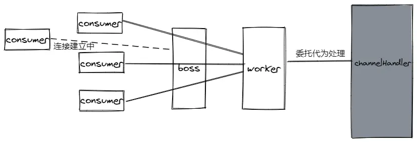

# Dubbo

不管使用哪种通讯框架，在网络通讯层面都需要完成以下基础的功能：

- 请求连接的建立，以netty为例dubbo会在tcp层为每个服务消费者和提供者之间建立TCP长连接。
- 发送数据，通过已经建立的TCP连接发送数据。
- 接收数据，通过已经建立的TCP连接接收数据。
- 关闭连接，关闭TCP长连接。

就以上功能作为展开点，我们以dubbo中服务提供方`NettyServer`启动过程开始分析。

```java
// Boss线程组只有一个，负责创建连接
protected EventLoopGroup createBossGroup() {
    return NettyEventLoopFactory.eventLoopGroup(1, "NettyServerBoss");
}
// Worker线程组
//  size：取属性iothreads和可用核心数+1的较小值。如果按个Provider实例的可用核心数超过32，设置该参数，否则达不到最大吞吐
protected EventLoopGroup createWorkerGroup() {
    return NettyEventLoopFactory.eventLoopGroup(this.getUrl().getPositiveParameter("iothreads", Constants.DEFAULT_IO_THREADS), "NettyServerWorker");
}

protected void initServerBootstrap(final NettyServerHandler nettyServerHandler) {
    boolean keepalive = this.getUrl().getParameter("keep.alive", Boolean.FALSE);
    ((ServerBootstrap)((ServerBootstrap)this.bootstrap
            .group(this.bossGroup, this.workerGroup)
            // 根据shouldEpoll（是否支持epoll来选择EpollServerSocketChannel或NioServerSocketChannel）
            .channel(NettyEventLoopFactory.serverSocketChannelClass()))
            // 重用本地地址端口，如果服务器意外关闭后再次启动，可以立即绑定到之前使用的地址和端口。
            .option(ChannelOption.SO_REUSEADDR, Boolean.TRUE))
            // Nagle算法，将小的网络包合并成较大的网络包提升网络效率，但会增加传输延迟。一般对延迟敏感的场景都会禁用Nagle算法。
            .childOption(ChannelOption.TCP_NODELAY, Boolean.TRUE)
            // TCP Keep-Alive，默认为false
            .childOption(ChannelOption.SO_KEEPALIVE, keepalive)
            // PooledByteBufAllocator是Netty提供的一种内存分配器实现，它可以重用ByteBuf对象的内存，提高内存的利用率和性能。
            .childOption(ChannelOption.ALLOCATOR, PooledByteBufAllocator.DEFAULT)
            .childHandler(new ChannelInitializer<SocketChannel>() {
        protected void initChannel(SocketChannel ch) throws Exception {
            int closeTimeout = UrlUtils.getCloseTimeout(NettyServer.this.getUrl());
            NettyCodecAdapter adapter = new NettyCodecAdapter(NettyServer.this.getCodec(), NettyServer.this.getUrl(), NettyServer.this);
            // 处理https
            ch.pipeline().addLast("negotiation", new SslServerTlsHandler(NettyServer.this.getUrl()));
            ch.pipeline()
                    // 解码 读数据
                    .addLast("decoder", adapter.getDecoder())
                    // 编码 写数据
                    .addLast("encoder", adapter.getEncoder())
                    // IdleStateHandler
                    .addLast("server-idle-handler", new IdleStateHandler(0L, 0L, (long)closeTimeout, TimeUnit.MILLISECONDS))
                    // netty核心，实现了ChannelDuplexHandler，双工通信
                    .addLast("handler", nettyServerHandler);
        }
    });
}

public static Class<? extends ServerSocketChannel> serverSocketChannelClass() {
    return shouldEpoll() ? EpollServerSocketChannel.class : NioServerSocketChannel.class;
}

// 关键知识
// netty每个连接对应一个Channel，每个Channel对应一个ChannelPipeline：用来管理Channel上的ChannelHandler（责任链）
// ChannelHandler有ChannelInboundHandler和ChannelOutboundHandler两类，分别表示入站（读）和出站（写）的流程编写
// Netty提供了很多开箱即用的ChannelHandler，方便实现HTTP，WebSocket等协议

// ByteToMessageDecoder: 将接收的字节流解码为消息对象, 将解码后的消息传递给下一个Handler
// SslServerTlsHandler继承了它，可以方便处理多种，二进制文本数据
public class SslServerTlsHandler extends ByteToMessageDecoder { 
    
}
```

以上代码是使用netty中非常常见的用法，分别创建boss角色和worker角色两个工作组。其中boss角色负责连接的建立以及通信通道的建立，通道建立完成之后通讯的工作以及通道的断开则由worker角色负责。

上面代码中涉及到`NettyServerHandler`这个对象，该对象继承自`ChannelDuplexHandler`（对netty不熟悉的小伙伴可以将该对象理解为一个双向的通道，提供了读写的功能，dubbo的通讯也是由此展开的）。

```xml
public class NettyServerHandler extends ChannelDuplexHandler {
    
    // 省略代码
    @Override
    public void channelRead(ChannelHandlerContext ctx, Object msg) throws Exception {
        NettyChannel channel = NettyChannel.getOrAddChannel(ctx.channel(), url, handler);
        handler.received(channel, msg);
    }
    
    @Override
    public void write(ChannelHandlerContext ctx, Object msg, ChannelPromise promise) throws Exception {
        super.write(ctx, msg, promise);
        NettyChannel channel = NettyChannel.getOrAddChannel(ctx.channel(), url, handler);
        handler.sent(channel, msg);
    }
    
}
```

上面代码不需要去精读就可以发现明显的规律，`NettyServerHandler`类重写的`channelRead`、`write`等方法都将具体的调用委托给了**`ChannelHandler`**这个对象。目前为止我们的线程模型可以简化为



[Dubbo 负载均衡和容错](load-balancing-fault-tolerance.md)

[Dubbo的SPI思想](spi-thought.md)