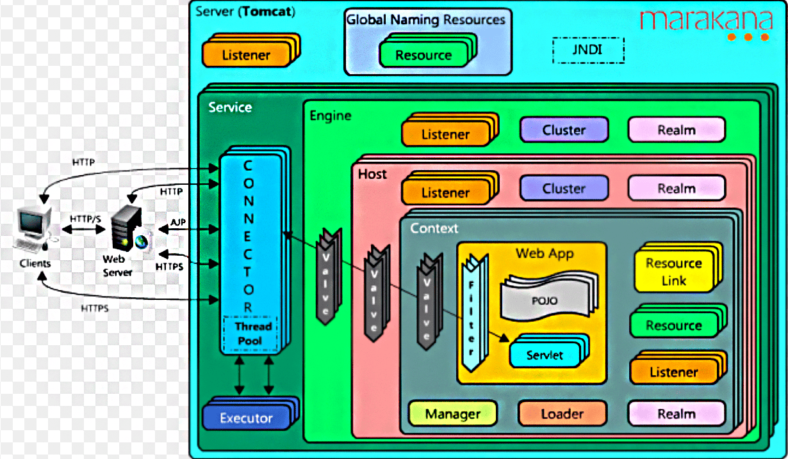

# Tomcat

### Components

**Server**

`Server` provides a graceful solution to startup and stop the whole system, you don’t have to separately startup the `Connector` and `Container`. It's on the top hierarchy of Tomcat.

**Service**

A Server can run many Services. For instance, a Tomcat could involve Order Service, Payment Service, User Service, etc. The implementation of Server `StandardServer` can contain one or multiple Services. The implementation of Service `StandardService` calls `Container` interface, actually calls `Servlet Engine` . The `StandardService` also specify the Server it belongs to.

**Container**

Servlet Container interface, components like Engine, Host, Context and Wrapper all extends Container interface, in other words they are all Containers.

**Connector**

A Connector connects Service and Container. It is registered in a Service, and used to forward requests from the client to Container. That’s why it is called as Connector.

Protocols supported: AJP, HTTP, HTTPS

**Other**

- Manager for manage session
- Logger for manage log
- Loader for Context to load class
- Pipeline and Value to filter
- Realm for authentication

*Connector将请求转发给Engine*

### A full trace for a request

URI: [http://localhost:8080/test/index.jsp](http://localhost:8080/test/index.jsp)

request is sent to port 8080, and processed by Coyote HTTP/1.1 Connector

- Connector forward the request to the Engine Service it belongs to
- Engine acquires request URI and routes to HOST
- Engine route to HOST named [localhost](http://localhost) (event if no HOST matches, localhost is default HOST)
- `localhost` HOST acquires path`/test/index.jsp` to match all Context it owns
- HOST match `/test` Context (if no match handle the request to `""` Context)
- path="/test” Context get request `/index.jsp` finding the corresponding servlet in mapping table
- Context match servlet with the URL PATTERN as `*.jsp` . For `JspServlet`, construct  `HttpServletRequest` and `HttpServletResponse`, then call `doGet` or `doPost`
- HOST return HttpServletResponse to Engine
- Engine return HttpServletResponse to Connector
- Connector return HttpServletResponse to client

### IO Model

Tomcat is based on NIO.

### **🧠 一、Tomcat 是基于 NIO 的吗？**

是的，**Tomcat 从 8.x 版本开始默认使用 NIO（非阻塞 I/O）**。不过需要注意一点是：

> Tomcat 是基于 NIO 的网络通信模型，但它是基于线程池的请求处理模型。
> 

---

### **🧠 二、Servlet 的请求处理机制**

Servlet 是 Java EE 的规范，而 Tomcat 是一个 Servlet 容器，负责执行 Servlet。

- **Servlet 是基于 BIO 的**，即每个请求会在一个线程中被处理。
- 但是，**Tomcat 的网络层是基于 NIO 实现的**（如 `NioEndpoint`) 用于监听连接，提高网络性能。
- **请求的线程池调度是由 Tomcat 完成的**，而不是直接使用 NIO 的事件驱动模型。

---

### **🧠 三、Tomcat 如何调度线程处理请求**

Tomcat 会使用 **线程池（ThreadPool）** 来分配处理请求的线程：

| **类名** | **作用说明** |
| --- | --- |
| `Executor` | 代表线程池，用于异步处理请求 |
| `ThreadPoolExecutor` | 具体实现线程池的类，如 `TomcatThreadPool`、`CachedThreadPool` 等 |
| `ConnectionHandler` | 处理客户端连接，属于 NIO 层 |
| `NioEndpoint` | 是 Tomcat 的网络层，基于 NIO 实现，用于监听网络请求 |
| `Acceptor` | 在 NIO 层中负责接收客户端连接 |
| `Worker` | 在 NIO 层中负责处理实际请求，并将它们提交给线程（例如 `ThreadPoolExecutor`) |

---

### **🧠 四、请求的处理流程**

1. 客户端发送请求 → 通过 NIO 层的 `NioEndpoint` 接收。
2. `NioEndpoint` 将请求分发给 `Worker`（这是基于线程池的）。
3. `Worker` 拿到请求后交给对应的 `Servlet` 处理。
4. `Servlet` 本身是同步阻塞的，所以处理请求的线程会被“占用”直到处理完成。

> 这意味着虽然 Tomcat 的网络栈用了 NIO，但它是混合模型：多路复用（NIO） + 线程池（BIO）。
> 

### **🧠 一、Worker 是一个线程吗？**

不是。Worker **是一个线程池中的线程角色**，在 Tomcat 中，它代表网络请求的“处理者”。

- Tomcat 的 `NioEndpoint` 负责：
    - 接收客户端连接（通过非阻塞 I/O）
    - 将请求“分发”给Worker处理
- `Worker` 是一个 **线程池中的线程**，可以是 `ThreadPoolExecutor` 的线程，也可以是 `CachedThreadPool` 的线程。

> 也就是说，Worker 组合了 非阻塞 I/O 和 阻塞的线程池处理，从而成为一个 混合模型。
> 

---

### **🧠 二、NIO Endpoint 分发请求后，如何确认请求完成并返回给客户端？**

### **✅ 1. 多路复用（NIO）监听请求**

Tomcat 使用 **NIO** 的 `NioEndpoint` 来监听网络请求。这个模块使用 **Selector（选择器）**，负责管理多个 Socket 连接。

- `NioEndpoint` 在监听套接字（acceptor thread）时使用 **NIO 非阻塞方式**。
- 一旦有新的请求到达（如 HTTP 请求），它会将该请求交给 **Worker 线程池**。

### **✅ 2. Worker 线程池处理请求——同步阻塞处理**

- `Worker` 线程池中的线程是 **同步阻塞的**，每个线程处理一个请求，直到该请求被处理完毕。
- 请求被发送到线程池后，线程会执行 Servlet 的 `service()` 方法，进行 **同步处理**。
- 该线程会在处理完成之后，通过 **写入通道（write）** 来将响应返回给客户端。

### **✅ 3. 响应的写入过程**

- 当请求被处理完成，`Worker` 线程会通过阻塞方式（通常是 `SocketChannel.write()`）将响应数据写回给客户端。
- 写入操作是同步进行的，但是写入操作本身是 **非阻塞的**，因为 Tomcat 的 I/O 使用 NIO。
- 写入完成后，线程不再占用（如果 `Servlet` 没有阻塞调用），然后可以去处理下一个请求。

> 也就是说，虽然 Worker 线程池是同步处理请求的，但它们在网络层的任务是通过 NIO 完成的，这种设计在高并发场景下具有优势。
> 

---

### **🧠 三、Netty 和 Tomcat 的异步处理对比**

| **项目** | **Netty（异步非阻塞）** | **Tomcat（NIO + 线程池处理）** |
| --- | --- | --- |
| 请求处理模型 | 异步、非阻塞（使用 EventLoop） | 同步、阻塞（使用 Worker 线程池） |
| I/O 模式 | 基于 NIO 的事件驱动模型 | NIO 的 Selector 监听 + 线程池处理请求 |
| 写入响应方式 | 异步（通过 write 方法） | 同步（通过 write 方法阻塞式返回） |
| 消耗资源 | 少（事件循环模型，线程少） | 多（线程池线程多，每个请求一个线程） |
| 可扩展性 | 更高（适合高并发） | 中等（适合中等负载场景） |

### **Tomcat 的 `NioEndpoint` 作用详解**

你提到的流程基本正确，但我们可以更清晰地描述它的工作方式：

1. **监听连接（Accept）**
    - `NioEndpoint` 会使用一个 **Acceptor 线程**，通过 `Selector` 监听所有已完成的连接请求（也叫 accept 事件）。
    - 它不是每次为每个请求都创建一个新的 `SocketChannel`；
    - 而是 **复用已有 Channel** —— 每个连接会有一个对应的 `SocketChannel`，它会在连接建立后保持活跃，直到连接关闭。
2. **请求分发**
    - 新建立的连接（如 HTTP 请求）会被封装进 **SocketChannel** 中，然后将这个 Channel 交给 **Worker 线程池** 中的某个线程。
    - `Worker` threads 是 **从线程池中获取** 的，而不是每次都创建新的线程。
    - 这些线程会调用 **Servlet** 的 `service()` 方法来处理请求。
3. **处理请求与写回响应**
    - `Servlet` 的处理是 **阻塞的**（在大多数情况下），即一个线程只能处理一个请求。
    - 一旦处理完成，线程会将响应数据写入 **SocketChannel**，然后这个 Channel 可能会被释放或复用。
    - 如果是 HTTP 请求（如 GET/POST），tomcat 会 **关闭连接**（如果是短连接），或者是 **保持连接**（如果是长连接，如 HTTP/1.1 或 WebSocket）。

### **`NioEndpoint` 的关键组件详解**

### **1. Acceptor 线程**

- **作用**：专门用于处理连接（accept）事件。
- **工作方式**：它是 **单一线程**，负责监听客户端连接请求（accept）并创建 `SocketChannel`。
- 它不处理请求内容，只是负责 **建立连接**，然后将连接交给 `Poller`（或 `Worker`）处理。
- **监听的是 Socket 的 accept 事件**，即连接建立的操作。

### **2. Selector**

- **作用**：负责管理多个 SocketChannel，通过 **非阻塞 I/O 多路复用** 完成请求的读取和写入。
- **线程**：通常运行在一个或多个 **Poller 线程** 中。
- **职责**：
    - 等待事件（如读请求、写响应）发生；
    - 将事件分发给对应的线程处理；
    - 它不是“接收请求”，而是“处理 I/O 事件”，比如读取请求内容、发送响应。

### **3. Worker 线程**

- **作用**：从线程池中获取线程，负责 **调用 Servlet 处理请求**。
- **线程池**：通常由 `Executor` 管理，配置可以调整线程数（如 `maxThreads`）。
- **不直接处理网络 I/O**，而是负责“逻辑处理”，即执行 `Servlet` 的 `service()` 方法。
- 它会和 `Selector` 协作：当请求内容被读取完后，`Selector` 将事件分发给 `Worker` 线程进行处理。

https://pdai.tech/md/framework/tomcat/tomcat-x-arch.html