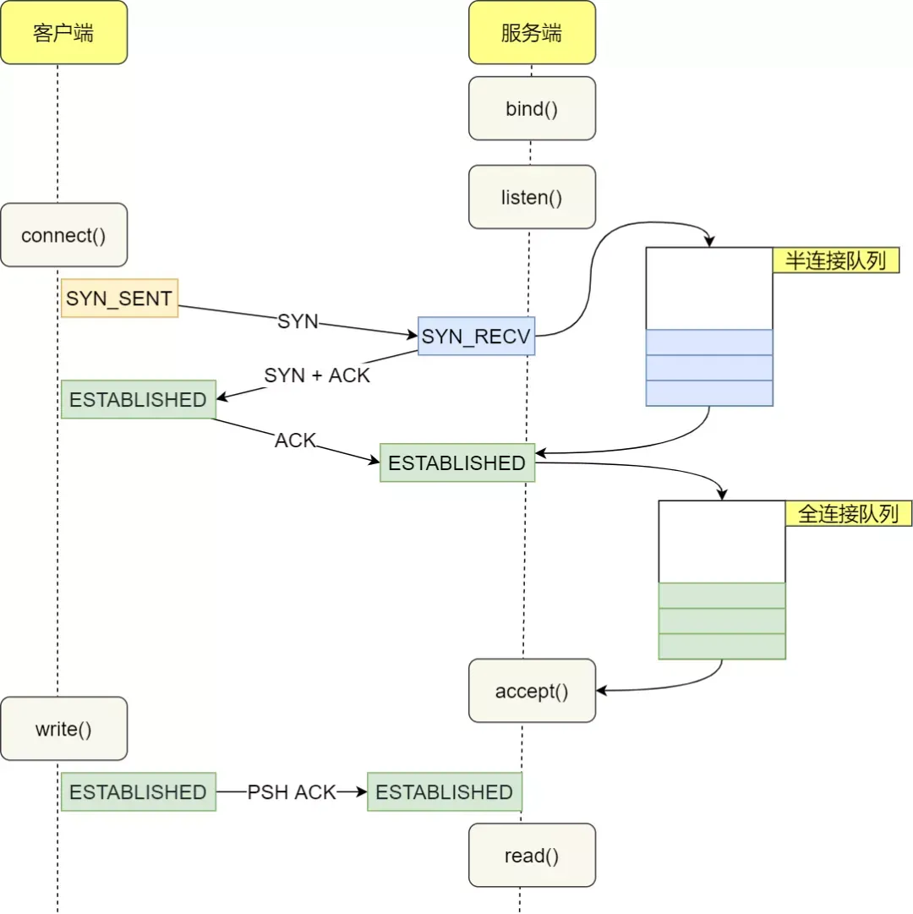
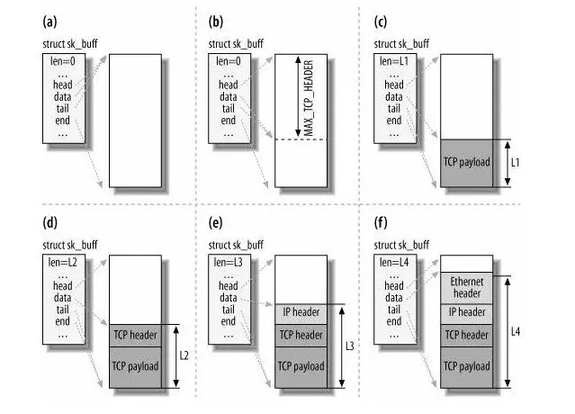
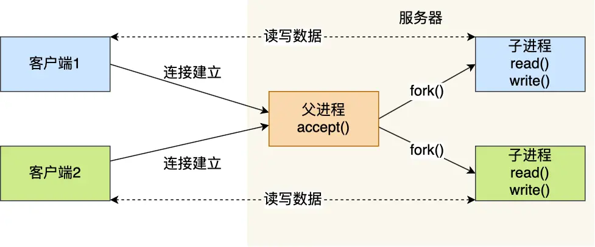
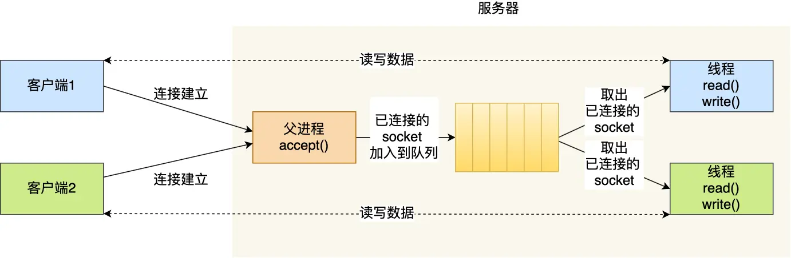

# linux IO and socket

网络编程里面最基础的部分就是linux IO 和 socket编程。

### Socket

想要客户端和服务端在网络中通信，必须使用Socket编程。它是进程间通信比较特别的方式：跨主机通讯。

socket：ip + 端口号

两个进程通信时，需要各自创建一个Socket，以此来发送和接收数据。

创建五元组（source ip，target ip，source port，target port，protocol）建立连接。连接建立好后，两个进程各有一个socket来标识，这两个socket组成的socket pair也就唯一标识了一个连接。

创建Socket时，可以指定网络层协议（IPV4,IPV6)和传输层协议（TCP，UDP）

UDP的Socket编程相对简单，这里介绍基于TCP的Socket编程。

服务端进程先运行，等待客户端的连接和数据，过程如下：

- 服务端调用 `socket()` 函数，创建网络层协议为IPV4，传输层协议为TCP的socket，接着调用`bind()` 函数，给这个socket绑定一个ip地址和端口，绑定的目的是什么？
    - 绑定端口：当Linux内核收到TCP报文，通过TCP头里面的端口号，来找到进程并将数据传递给它
    - 绑定IP地址：一台机器时可以有多个网卡的，每个网卡有对应的IP。当绑定一个网卡时，内核收到该往该网卡上的包，才会发给我们
- 绑定完IP地址和端口后，可以调用`listen()` 函数进行监听，此时对应TCP状态图中的`listen`，如果要判定服务器中的一个网络程序有没有启动，可以通过`netstat`命令查看对应的端口号是否有被监听
- 服务端进入监听状态后，通过调用`accept()`函数 ，来从内核获取客户端的连接，如果没有客户端连接，则会阻塞等待客户端连接的到来。

客户端怎么发起连接？

- 客户端创建好Socket后，调用`connect()` 函数发起连接，该函数的参数要指明服务端的IP地址和端口号，然后经典的TCP三次握手开始了。
- 在TCP连接的过程中，服务器的内核为每个Socket维护两个队列
    - 一个是 [还没完全建立] 连接的队列，称为TCP半连接队列。这个队列都是没有完成三次握手的连接，此时服务端处于`sync_rcvd` 的状态
    - 一个是 [已经建立] 连接的队列，称为 TCP全连接队列。这个队列都是完成三次握手的连接，此时服务端处于 `established` 状态
- 当TCP全连接队列不为空后，服务端的`accept()` 函数，就会从内核的TCP全连接队列里拿出一个已经完成连接的Socket返回应用程序，后续数据传输都用这个socket

<aside>
💡

注意，监听的Socket和真正用来传数据的Socket是两个：

- 一个叫 监听Socket
- 一个叫 已连接Socket
</aside>

- 连接建立后，客户端和服务端就开始相互传输数据，双发都可以通过 `read()` 和 `write()` 函数来读写数据

看到这，不知道你有没有觉得读写Socket和读写文件一样。

是的，基于Linux一切皆文件的理念，在内核中Socket也是以 [文件] 的形式存在，也是有对应的文件描述符。

文件描述符的作用是什么？每个进程都有一个数据结构 `task_struct`，该结构体里有一个指向 [文件描述符数组] 的成员指针。该数组列出这个进程打开的所有文件的文件描述符。数组的下表就是文件描述符，是一个整数，而数组的内容是一个指针，指向内核中所有打开的文件的列表，也就是说内核可以通过文件描述符找到对应打开的文件。

然后每个文件都有一个inode，Socket文件的inode指向内核的Socket结构，这个结构体有两个队列：发送队列和接收队列，两个队列里面保存的是一个个 `struct sk_buff` 用链表的组织形式串起来。

sk_buff 可以表示各个层的数据包，在应用曾数据包叫data，在TCP层称为segment，在IP层叫packet，在数据链路层称为frame。

你可能会好奇为什么全部数据包只用一个结构体来描述呢？

协议栈采用的是分层结构，上层的向下层传递数据时数据需要增加包头，下层向上层数据传递时又需要去掉包头，如果每一层都是用一个结构体，在层之间传递数据的时候，就要发生多次拷贝，将大大降低CPU效率

于是为了在层级之间传递数据时**不发生拷贝**，只用 `sk_buff` 一个结构体来描述所有网络包，是如何做到的呢？是通过调整 sk_buff 中 `data` 的指针，比如：

- 当接收报文时，从网卡驱动开始，通过协议栈层层往上传送数据报文，通过增加sk_buff→data的值，来逐步剥离协议首部
- 当发送报文时，创建sk_buff 结构体，数据缓存区的头部预留足够的空间，用来填充各层首部，在经过向下各下层协议时，通过减少sk_buff→data的值来增加协议首部

你可以从下面这张图看到，当发送报文时，data 指针的移动过程。

### 如何服务更多用户？

前面提到的TCP Socket调用流程是最简单最基本的，只能一对一通信，因为使用的是同步阻塞的方式，服务端还没有处理完一个客户端的网络IO时，或者读写操作发生阻塞时，其他客户端无法与服务端连接。

如果只能服务一个客户端那就太浪费了，因此需要改进网络IO模型以支持更多客户端

首先问个问题，你知道服务器单机理论最大连接数是多少吗？

TCP连接是由四元组唯一确认的：本机IP，本机端口，对端IP，对端端口

服务器作为服务方，通常会在本地监听一个端口，等待客户端连接。因此服务器的本地IP和端口是固定的，于是对服务端TCP连接的四元组只有对端的IP和端口是会变化的，所以最大TCP连接数 = 客户端IP数 * 客户端端口数

对于IPV4，客户端的IP数最多为2^32，客户端的端口数最多为2^16，服务器单机最大TCP连接数为2^48.

这个理论值相当“丰满”，但是服务器肯定承载不了那么大的连接数，主要会受两个方面的限制：

- 文件描述符，Socket实际上是一个文件，就会对应有一个文件描述符。Linux下单个进程打开的文件描述符是有限制的，没有经过修改一般是1024. 不过可以通过ulimit增大文件描述符数目。
- 系统内存，每个TCP连接在内核都有对应的数据结构，意味着每个连接占用一定内存。

那如果服务器的内存只有 2 GB，网卡是千兆的，能支持并发 1 万请求吗？

并发1万请求，也就是经典的C10K问题，C是Client的首字母，C10K计时单机同时处理10万请求

从意见资源看，对于2G内存千兆网卡的服务器，如果每个请求处理占用不到200KB内存和100Kbit网络带宽就可以满足1万并发

不过，想要真正实现C10K的服务器，需要考虑在于服务器的网络IO模型，效率低的模型会加重系统开销，从而里C10K目标越来越远。

### 多进程模型

基于最原始的阻塞网络IO，如果服务器要支持多个客户端，比较传统的方式，就是使用**多进程模型**，也就是为每个客户端分配一个进程来处理请求。

服务器的主进程负责监听客户端的连接，一旦与客户端连接完成，accept() 函数就会返回一个[已连接Socket] ，这时就通过 fork() 函数创建一个子进程，实际上就把父进程所有相关的东西都复制一份，包括文件描述符，内存地址空间，程序计数器，执行的代码等。

这两个进程刚复制完的时候，几乎一模一样。不过会根据**返回值**来区分是父进程还是子进程，如果返回是0，则是子进程；如果返回是其他的整数，则是父进程。

正因为子进程会**复制父进程的文件描述符**，于是就可以直接用 [已连接Socket]，这时就可以直接使用 [已连接Socket] 和客户端通信了。

可以发现，子进程不需要关心[监听Socket]，只需要关心 [已连接Socket]；父进程则相反，将客户服务交给子进程来处理，因此父进程不需要关心 [已连接Socket]，只需要关心 [监听Socket]

下面这张图描述了从连接请求到连接建立，父进程创建子进程为客户端服务。

另外，当[子进程] 退出时，实际上内核还会保留该进程的一些信息，也是会占用内存的。如果不做好”回收”工作，就会变成僵尸进程，随着僵尸进程越来越多会耗尽系统资源。

因此，父进程需要在子进程退出后回收资源，分别是调用 `wait()` 和 `waitpid()` 函数。

这种用多个进程来应付客户端的方式，应对100个客户端还是可以的。但当客户端数量达到一万时，肯定是扛不住的，因为每产生一个进程必定会占用一定的系统资源，而且进程间上下文切换开销很大（涉及到内存页表的切换），性能会大打折扣。

<aside>
💡

进程间上下文切换不仅包含虚拟内存，栈空间，全局变量等用户空间的资源，还包括内核堆栈，寄存器等内核空间的资源。

</aside>

### 多线程模型

线程是运行在进程中一个逻辑流，单进程可以运行多个线程。一个进程的线程共享进程的部分资源，比如文件描述符，进程空间，代码，全局数据，堆，共享库等。这些资源在上下文切换时不需要切换，只需要切换线程的私有数据例如线程栈，寄存器等不共享的数据。因此进程内的上下文切换比进程切换开销小很多。

当服务器与客户端完成TCP连接后，通过 `pthread_create()` 函数创建线程，然后将 [已连接Socket] 的文件描述符传递给线程函数，接着在线程里面和客户端通讯，从而达到并发处理的目的。

如果每来一个连接就创建一个线程，线程运行完后，还得操作系统销毁线程，虽说线程上下文切换的开销不大，但是如果频繁创建和销毁线，系统开销也是不小的。

那么，我们可以使用**线程池**来创建和回收线程，避免线程的频繁创建和销毁。所谓的线程池，就是提前创建若干个线程，这样有新连接建立时，将这个已连接的Socket放入到一个队列里面，然后线程池里的线程负责从队列中取出 [已连接Socket] 进行处理。

需要注意的是，这个队列是全局的，每个线程都会操作，为了避免多线程竞争，线程在操作这个队列的时候需要加锁。

[https://xiaolincoding.com/os/8_network_system/selete_poll_epoll.html#多线程模型](https://xiaolincoding.com/os/8_network_system/selete_poll_epoll.html#%E5%A4%9A%E7%BA%BF%E7%A8%8B%E6%A8%A1%E5%9E%8B)

诞生了三种高效的socket编程方法：`select，poll， epoll`

让单个线程能同时监听多个 IO 通道（如网络连接），当通道就绪（可读 / 可写）时再进行处理，从而高效支持高并发场景

### **核心差异：为什么 epoll/kqueue 更高效？**

1. **避免无意义的遍历**：
    - `select/poll` 每次调用都需要遍历所有监听的 FD 来判断是否就绪，即使只有少数 FD 就绪，也会扫描全部，高并发下效率极低。
    - `epoll/kqueue` 采用 **事件驱动模式**：内核会记录就绪的 FD 并维护一个 “就绪列表”，应用程序只需遍历这个列表，无需扫描全部 FD，效率随并发量提升更明显。
2. **FD 数量限制**：
    - `select` 受限于固定大小的数组（默认 1024 个 FD），如需突破需重新编译内核，极不灵活。
    - `epoll/kqueue` 无固定限制，能支持十万甚至百万级别的 FD 监听（如高并发服务器场景）。
3. **内存拷贝优化**：
    - `select/poll` 需要将用户态的 FD 集合拷贝到内核态，每次调用都有额外开销。
    - `epoll` 通过 `epoll_ctl` 预先注册 FD 到内核，后续操作无需重复拷贝，减少内存开销。

### 基础概念

- 用户空间和内核空间

32位操作系统，寻址空间是4G。这里的4G是虚拟地址空间的大小。

linux 将最高的1G给内核使用，称为内核空间，剩余的3G给用户进程使用，称为用户空间。

这样空间隔离，保证内核安全。

- 进程切换

内核完成，挂起A进程执行B进程，涉及到上下文切换，消耗资源。

- 进程阻塞

当前进程的行为，比如和其他进程通信等待数据返回。阻塞不占用CPU资源

- 文件描述符

linux一切皆文件。打开一个现有文件或创建新文件时，内核会向进程返回一个文件描述符。文件描述符的形式是一个非负整数，是一个指向该进程打开的文件记录表（由内核维护）的索引值。

- 缓存IO

和标准IO一个概念。用户进程需要读取内核数据时，数据先被拷贝到操作系统内核缓冲区（page cache），然后从缓冲区拷贝到用户进程的地址空间。

### Linux IO

应用程序发起一次read调用时，会经历以下阶段：

- 等待数据准备 Waiting for the data to be ready
- 将数据从内核拷贝到用户进程 Copying the data from kernel to process

**因为这两个阶段，linux产生了五种IO方式：**

- BIO Blocking IO
- NIO Non-blocking IO
- AIO Asynchronous IO
- 多路复用IO IO Multiplexing
- 信号驱动IO Signal driven IO

[https://zhuanlan.zhihu.com/p/452562548](https://zhuanlan.zhihu.com/p/452562548)

[https://xiaolincoding.com/os/8_network_system/zero_copy.html#为什么要有-dma-技术](https://xiaolincoding.com/os/8_network_system/zero_copy.html#%E4%B8%BA%E4%BB%80%E4%B9%88%E8%A6%81%E6%9C%89-dma-%E6%8A%80%E6%9C%AF)

操作系统内核中的磁盘高速缓存区是指操作系统为了提高数据读写效率而设置的一个临时存储区域。当程序需要从磁盘读取数据时，操作系统会先检查这个缓存区中是否已经有需要的数据。如果有，则直接从缓存区中读取；如果没有，则从磁盘读取数据并放入缓存区。这样可以减少直接访问磁盘的次数，从而提高系统的整体性能。同样地，当程序向磁盘写入数据时，操作系统也会先把数据存入缓存区，之后再由系统决定何时将这些数据实际写入到磁盘上。这种方式可以有效地合并多次写操作，减少磁盘I/O操作的次数，提升效率。

"PageCache"（页面缓存）是指计算机操作系统中的一种缓存机制，主要用于提高文件读取的速度。当程序请求读取一个文件时，操作系统会将文件的部分或全部内容加载到内存中的PageCache里。如果后续再次请求相同的数据，就可以直接从缓存中快速获取，而不需要重新从磁盘读取，这样可以显著减少I/O操作的时间，提升系统性能。

在现代的操作系统中，如Linux、Windows等，PageCache技术被广泛采用来优化文件系统的读写效率。它通过预先加载和延迟写入等策略，有效地利用了内存资源，使得文件操作更加高效。