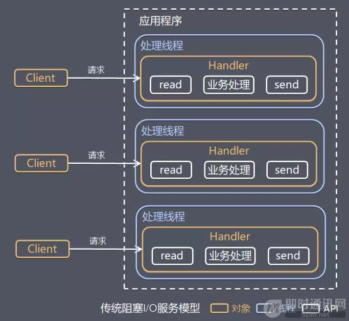
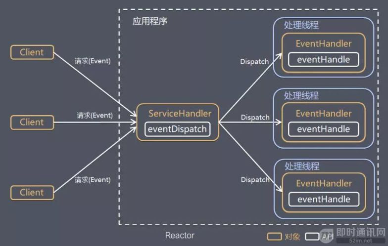
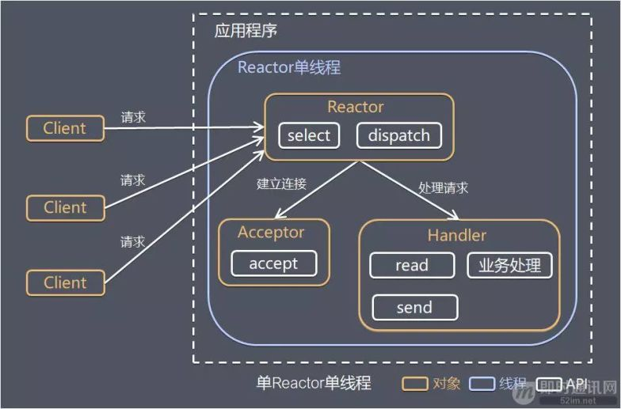

# 服务器进程-线程模型

## 传统阻塞IO服务模型

1. 采用阻塞式 I/O 模型获取输入数据
2. 每个连接都需要独立的线程完成数据输入，业务处理，数据返回的完整操作

存在问题：

1）当并发数较大时，需要创建大量线程来处理连接，系统资源占用较大；

2）连接建立后，如果当前线程暂时没有数据可读，则线程就阻塞在 Read 操作上，造成线程资源浪费。（空闲等待）

## Reactor模式

针对传统阻塞 I/O 服务模型的 2 个缺点，比较常见的有如下解决方案： 

1. 基于 I/O 复用模型：多个连接共用一个阻塞对象，应用程序只需要在一个阻塞对象上等待，无需阻塞等待所有连接。当某条连接有新的数据可以处理时，操作系统通知应用程序，线程从阻塞状态返回，开始进行业务处理；
2. 基于线程池复用线程资源：不必再为每个连接创建线程，将连接完成后的业务处理任务分配给线程进行处理，一个线程可以处理多个连接的业务。

I/O 复用结合线程池，这就是 Reactor 模式基本设计思想，如下图：

Reactor 模式，是指通过一个或多个输入同时传递给服务处理器的服务请求的事件驱动处理模式。

服务端程序处理传入多路请求，并将它们同步分派给请求对应的处理线程，Reactor 模式也叫 Dispatcher 模式。

即 I/O 多了复用统一监听事件，收到事件后分发(Dispatch 给某进程)，是编写高性能网络服务器的必备技术之一。

Reactor 模式中有 2 个关键组成：

- 1）Reactor：Reactor 在一个单独的线程中运行，负责监听和分发事件，分发给适当的处理程序来对 IO 事件做出反应。它就像公司的电话接线员，它接听来自客户的电话并将线路转移到适当的联系人；
- 2）Handlers：处理程序执行 I/O 事件要完成的实际事件，类似于客户想要与之交谈的公司中的实际官员。Reactor 通过调度适当的处理程序来响应 I/O 事件，处理程序执行非阻塞操作。

根据 Reactor 的数量和处理资源池线程的数量不同，有 3 种典型的实现：

- 1）单 Reactor 单线程；
- 2）单 Reactor 多线程；
- 3）主从 Reactor 多线程。

### **单 Reactor 单线程**

其中，Select 是前面 I/O 复用模型介绍的标准网络编程 API，可以实现应用程序通过一个阻塞对象监听多路连接请求，其他方案示意图类似。