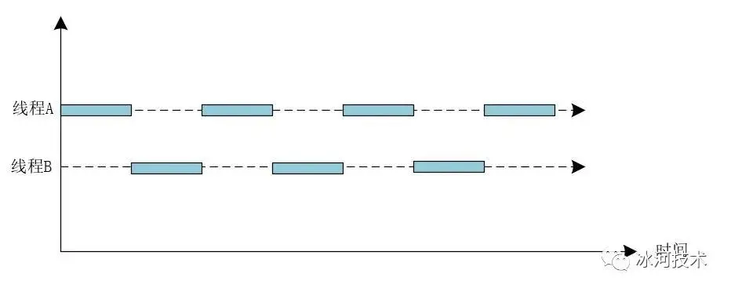
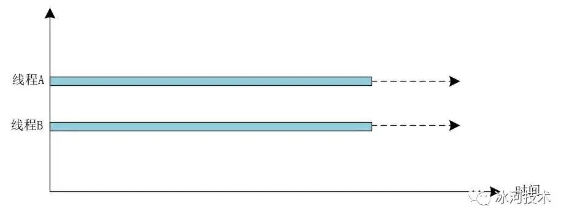

# Fork/Join 与工作窃取

分治思想在 Fork/Join 框架中的落地，以及工作窃取算法。

## Fork/Join 框架

### 前言

> 在JDK中，提供了这样一种功能：它能够将复杂的逻辑拆分成一个个简单的逻辑来并行执行，待每个并行执行的逻辑执行完成后，再将各个结果进行汇总，得出最终的结果数据。有点像Hadoop中的MapReduce。
ForkJoin是由JDK1.7之后提供的多线程并发处理框架。ForkJoin框架的基本思想是分而治之。什么是分而治之？分而治之就是将一个复杂的计算，按照设定的阈值分解成多个计算，然后将各个计算结果进行汇总。相应的，ForkJoin将复杂的计算当做一个任务，而分解的多个计算则是当做一个个子任务来并行执行。
> 

### java并发编程历史

- java 1 支持thread，synchronized
- java 5 引入thread pools，blocking queues， concurrent collections，locks，condition queues
- java 7 加入fork-join
- java 8 加入parallel streams

### 并发和并行

并发指的是在同一时刻，只有一个线程能够获取到CPU执行任务，而多个线程被快速的轮换执行，这就使得在宏观上具有多个线程同时执行的效果，并发不是真正的同时执行，并发可以使用下图表示



并行指的是无论何时，多个线程都是在多个CPU核心上同时执行的，是真正的同时执行。



[分治法](fork-join.md)

### fork join 并行处理框架

Java 1.7 引入了一种新的并发框架—— Fork/Join Framework，主要用于实现“分而治之”的算法，特别是分治之后递归调用的函数。

在Java中，ForkJoin框架与ThreadPool共存，并不是要替换ThreadPool
其实，在Java 8中引入的并行流计算，内部就是采用的ForkJoinPool来实现的。

```java
public class SumArray {
    public static void main(String[] args){
        List<Integer> numberList = Arrays.asList(1,2,3,4,5,6,7,8,9);
        numberList.parallelStream().forEach(System.out::println);
    }
}
```

这段代码的背后就使用到了ForkJoinPool。

<aside>
💡

说到这里，可能有读者会问：**可以使用线程池的ThreadPoolExecutor来实现啊？为什么要使用ForkJoinPool啊？ForkJoinPool是个什么鬼啊？！** 接下来，我们就来回答这个问题。

</aside>

### **ForkJoin框架原理**

ForkJoin框架是从jdk1.7中引入的新特性,它同ThreadPoolExecutor一样，也实现了Executor和ExecutorService接口。它使用了一个无限队列来保存需要执行的任务，而线程的数量则是通过构造函数传入，如果没有向构造函数中传入指定的线程数量，那么当前计算机可用的CPU数量会被设置为线程数量作为默认值。

ForkJoinPool主要使用**分治法(Divide-and-Conquer Algorithm)**来解决问题。典型的应用比如快速排序算法。这里的要点在于，ForkJoinPool能够使用相对较少的线程来处理大量的任务。比如要对1000万个数据进行排序，那么会将这个任务分割成两个500万的排序任务和一个针对这两组500万数据的合并任务。以此类推，对于500万的数据也会做出同样的分割处理，到最后会设置一个阈值来规定当数据规模到多少时，停止这样的分割处理。比如，当元素的数量小于10时，会停止分割，转而使用插入排序对它们进行排序。那么到最后，所有的任务加起来会有大概200万+个。问题的关键在于，对于一个任务而言，只有当它所有的子任务完成之后，它才能够被执行。

所以当使用ThreadPoolExecutor时，使用分治法会存在问题，因为ThreadPoolExecutor中的线程无法向任务队列中再添加一个任务并在等待该任务完成之后再继续执行。而使用ForkJoinPool就能够解决这个问题，它就能够让其中的线程创建新的任务，并挂起当前的任务，此时线程就能够从队列中选择子任务执行。

[work-stealing 工作窃取算法](fork-join.md)


## 分治思想

> 把一个规模大的问题划分为规模较小的子问题，然后分而治之，最后合并子问题的解得到原问题的解。
> 

### **步骤**

①分割原问题；

②求解子问题；

③合并子问题的解为原问题的解。

我们可以使用如下伪代码来表示这个步骤。

```sql
if(任务很小）{
    直接计算得到结果
}else{
    分拆成N个子任务
    调用子任务的fork()进行计算
    调用子任务的join()合并计算结果
}
```

在分治法中，子问题一般是相互独立的，因此，经常通过递归调用算法来求解子问题。

### **典型应用**

- 二分搜索
- 大整数乘法
- Strassen矩阵乘法
- 棋盘覆盖
- 合并排序
- 快速排序
- 线性时间选择
- 汉诺塔


## 工作窃取算法

假如我们需要做一个比较大的任务，我们可以把这个任务分割为若干互不依赖的子任务，为了减少线程间的竞争，于是把这些子任务分别放到不同的队列里，并为每个队列创建一个单独的线程来执行队列里的任务，线程和队列一一对应，比如A线程负责处理A队列里的任务。但是有的线程会先把自己队列里的任务干完，而其他线程对应的队列里还有任务等待处理。干完活的线程与其等着，不如去帮其他线程干活，于是它就去其他线程的队列里窃取一个任务来执行。而在这时它们会访问同一个队列，所以为了减少窃取任务线程和被窃取任务线程之间的竞争，通常会使用双端队列，被窃取任务线程永远从双端队列的头部拿任务执行，而窃取任务的线程永远从双端队列的尾部拿任务执行。

**工作窃取算法的优点：**

充分利用线程进行并行计算，并减少了线程间的竞争。

**工作窃取算法的缺点：**

在某些情况下还是存在竞争，比如双端队列里只有一个任务时。并且该算法会消耗更多的系统资源，比如创建多个线程和多个双端队列。

**Fork/Join框架局限性：**

对于Fork/Join框架而言，当一个任务正在等待它使用Join操作创建的子任务结束时，执行这个任务的工作线程查找其他未被执行的任务，并开始执行这些未被执行的任务，通过这种方式，线程充分利用它们的运行时间来提高应用程序的性能。为了实现这个目标，Fork/Join框架执行的任务有一些局限性。

（1）任务只能使用Fork和Join操作来进行同步机制，如果使用了其他同步机制，则在同步操作时，工作线程就不能执行其他任务了。比如，在Fork/Join框架中，使任务进行了睡眠，那么，在睡眠期间内，正在执行这个任务的工作线程将不会执行其他任务了。

（2）在Fork/Join框架中，所拆分的任务不应该去执行IO操作，比如：读写数据文件。

（3）任务不能抛出检查异常，必须通过必要的代码来出来这些异常。

参考：

[https://github.com/oldratlee/translations/blob/master/a-java-fork-join-framework/README.md](https://github.com/oldratlee/translations/blob/master/a-java-fork-join-framework/README.md)
