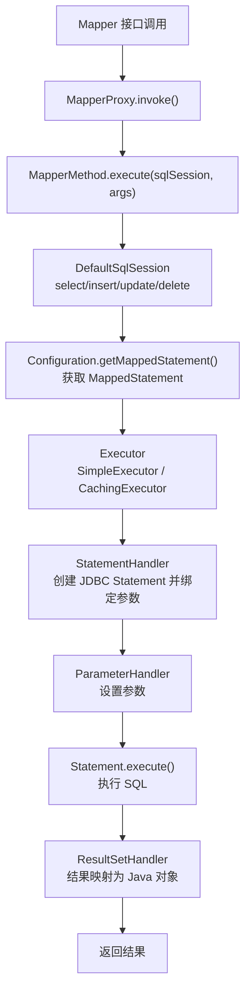

# MyBatis 执行链路

MyBatis 的一次调用，从 Mapper 接口代理到最终 JDBC 执行，跨越「接口层 → 核心处理层 → 基础层」。下图按调用顺序串起关键组件。

## 调用链拆解

- **依赖注入**：Mapper 声明 → Spring 启动注入 Mapper 实例（MapperProxy）。
- **Mybatis 调用**：Mapper 调用 → JdkDynamicProxy.invoke()（target 为实例化的 MapperProxy）→ ReflectiveMethodInvocation.proceed → AopUtils.invokeJoinpointUsingReflection → MapperProxy 代理方法调用 → `mapperMethod.execute(sqlSession, args)`。
- **SqlSession 执行**：SqlSession 执行 Mapper 方法（DefaultSqlSession）→ 通过 Configuration 拿到 mapper 方法的 MappedStatement → Executor.doQuery → 组装真正的 Statement 执行 → ResultHandler 解析结果。

## 分层结构

### 接口层

提供对外 API，封装底层操作；例如 SqlSession 封装了 CRUD 操作。

- SqlSession：默认实现 DefaultSqlSession。核心数据库操作：insert，selectOne
- SqlSessionFactory：基于 Configuration 构建，用于创建 SqlSession
- **SqlSessionFactoryBuilder**：解析 Mybatis 配置，构建 SqlSessionFactory
- Mapper：定义的 Mapper 通过扫描或注解，实现依赖注入生成 MapperProxy 代理类

### 核心处理层

SQL 执行，结果映射，缓存管理。

- Executor：SimpleExecutor 创建 Statement 并执行
- MapperProxy：Mapper 接口的代理类实现
- MapperRegistry：管理 Mapper 的注册
- MappedStatement：封装 SQL 语句的信息，参数结果类型
- StatementHandler：根据 ms 创建 JDBC 的 Statement
- ResultSetHandler：将 JDBC 查询结果映射到 Java 对象
- Interceptor：拦截 Executor 和 StatementHandler，实现语句拦截功能扩展（日志、加密、分页），在 SqlSessionFactory 的 Plugin 属性配置（获取 MappedStatement，修改参数）

### 基础层

全局基础设施。

- Configuration：全局配置，存储 DataSource，事务管理器，映射器，类型处理器，插件
- DataSource：JDBC 数据源
- Transaction：事务接口
- TypeHandler：类型映射处理

拓展阅读：[MyBatis 生成数据库 ID](mybatis-generate-id.md)
